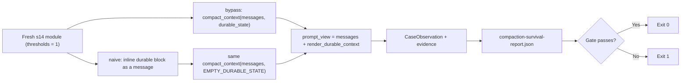

# Compaction Survival Evaluation

[English](./README.en.md)

> 反事实门禁：同样的事实与待办，走 s14 的 durable 旁路能挺过有损压缩；塞进 messages 再压缩就会丢。

## 代码架构图



## 运行

```bash
python3 examples/compaction_survival_eval/code.py
```

不需要 API key。在一个全新 s14 模块实例上把 `TOKEN_THRESHOLD`、`MAX_TOOL_RESULT_TOKENS` 设为 1、`KEEP_RECENT_TURNS` 设为 6，让 L1/L3/L4 都真正触发，并用固定的对抗摘要器。报告写到 `.tmp/compaction-survival-eval/compaction-survival-report.json`（`--output-dir` 可改）；门禁失败退出码为 1。

## 对照

| 编排 | 怎么做 | fact / pending 在送给模型的内容里 |
|---|---|---|
| 旁路（章节） | `compact_context(messages, state, ...)` | 都在 |
| 内联（naive） | 先把 `render_durable_context(state)` 插成一条 user 消息，再走同一个 `compact_context(..., EMPTY_DURABLE_STATE, ...)` | 都不在 |

内联版本丢东西的原因是章节自己的 L3 修剪和 L4 摘要，不是示例另写的清空函数。门禁 `durable_bypass_survives_lossy_compaction` 要求旁路两条都在、且内联两条都丢：内联变红正是门禁检出了问题，此时整体 `passed` 为 true。

durable 原样带回、入参不变、对抗摘要下 render 仍列出来源与时间，这些由 `tests/test_context_compaction.py` 负责，本示例不重复。
