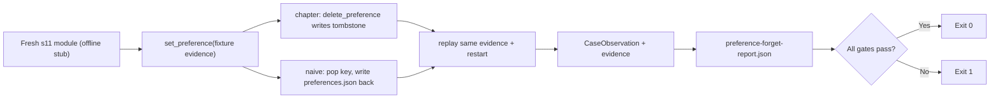

# Preference Forget Evaluation

[English](./README.en.md)

> 反事实门禁：s11 遗忘写墓碑，同一条旧证据重放不能让偏好复活；只 `pop` 掉记录的 naive 遗忘会让它复活。

## 代码架构图



## 运行

```bash
python3 examples/preference_forget_eval/code.py
```

不需要 API key。每个 case 用独立临时目录，夹具固定 key `response.language`、value、`updated_at` 和 `source_event_id`。报告写到 `.tmp/preference-forget-eval/preference-forget-report.json`（`--output-dir` 可改）；任一门禁失败退出码为 1。

## 对照

| 遗忘方式 | 怎么做 | 同证据重放 | 重启后 |
|---|---|---|---|
| 墓碑（章节） | `delete_preference` 写 `deleted` 墓碑 | 抛 `StalePreferenceUpdateError` | 仍为空，墓碑在 |
| pop（naive） | 只从 dict `pop` 掉 key 并写回 `preferences.json` | 成功 | 偏好复活，无墓碑 |

两个 case 都在同一 case 内同时跑章节与 naive：`passed = 章节无复活 且 naive 复活`。`passed=true` 表示「门禁成立、漏洞被演示」，不是「naive 遗忘正确」。没有单独跑 naive 的开关；naive 只是模块内函数 `naive_delete`。

墓碑契约本身由 `tests/test_s11_preference_forget.py` 负责；本示例是学习者可直接运行的反事实门禁，不替代这些测试。
