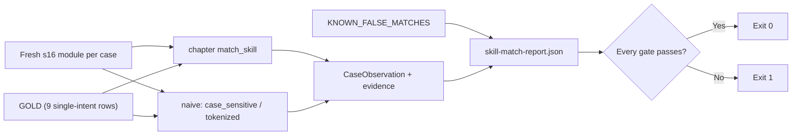

# Skill Match Regression Gates

[English](./README.en.md)

> 离线门禁：锁住 s16 `match_skill` 当前的关键词契约（`read_when` 触发词的小写子串包含），**不是匹配质量分数**。

## 代码架构图



## 运行

```bash
python3 examples/skill_match_eval/code.py
```

不需要 API key。打印每个门禁和已知误报，写 `.tmp/skill-match-eval/skill-match-report.json`（`--output-dir` 可改）；任一门禁失败退出码为 1。

## 它锁什么

`GOLD` 是 9 条单意图输入，全部按本仓库种子技能的 `read_when` 自写：大小写混写、多词触发（`ready to git push`）、中文无空格（`帮我做代码审查`）、空串和纯空白返回 `None`。只收单意图输入，所以 top-1 打分式匹配器同样应该能过。

| 门禁 | 章节实现 | 故意写错的 naive |
|---|---|---|
| `chapter_matches_gold` | GOLD 全过 | `case_sensitive`（忘了 `.lower()`）在 `Please COMMIT this` 上挂 |
| `token_split_fix_breaks_cjk` | GOLD 全过 | `tokenized`（按空格切词整词匹配）至少在 `帮我做代码审查`、`ready to git push` 上挂 |

`tokenized` 不是稻草人：它正是想修掉 `preview` → `code-review` 误报时最自然的写法，修掉了误报，却打断中文和多词触发。

每个门禁都重新加载一个全新的 s16 模块实例，`skill_index` 一定是种子索引；本示例从不调用 `create_skill` / `approve_skill`。`CaseDefinition` / `CaseObservation` / `CaseResult` 直接复用 [`memory_resilience_eval`](../memory_resilience_eval/)。

## 已知误报（只记录，不进门禁）

| 输入 | 当前结果 | 期望 |
|---|---|---|
| `preview the deploy` | `code-review`（`review` 是 `preview` 的子串） | `deploy-check` |
| `uncommitted changes` | `git-commit` | `None` |

报告里如实写出当前 `got`，标 `known_false_match`，不影响 `passed`。

## 和练习的关系

s16 练习 1 要改进匹配器：改进后的匹配器应先过 GOLD，再尝试把已知误报转正。转正后把该条从 `KNOWN_FALSE_MATCHES` 移进 `GOLD`，测试会提示这一步。
