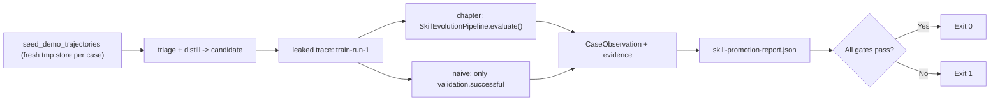

# Skill Promotion Evaluation

[English](./README.en.md)

> 反事实门禁：拿参与蒸馏的训练轨迹去「验证」候选技能，章节评测器判失败；只看 `validation.successful` 的偷懒评测器判通过。

## 代码架构图



## 运行

```bash
python3 examples/skill_promotion_eval/code.py
```

不需要 API key。每个 case 用独立的临时 `EvolutionStore`（章节评测会写入所给 store），用 `seed_demo_trajectories()` 造轨迹。报告写到 `.tmp/skill-promotion-eval/skill-promotion-report.json`（`--output-dir` 可改）；任一门禁失败退出码为 1。

## 对照

| 评测器 | 同一条泄漏轨迹 `train-run-1` | 失败项 |
|---|---|---|
| 章节 `evaluate()` | `passed=False` | 含 `held_out_trace`、`held_out_digest`（还有 `validation_succeeded`） |
| naive | `passed=True` | 无 |

- `chapter_rejects_leaked_validation`：章节评测器判失败，且失败项包含两项 held-out 检查。
- `naive_evaluator_accepts_leak`：naive 用公开的 `EvaluationReport` 构造器返回报告，不伪造字段、不存盘；`passed=true` 表示「泄漏被演示」，不是「naive 评测正确」。

发布只信报告，所以评测器必须可红。本示例停在 `evaluate()` 层，不调用 `promote()`，不演示发布，也不改 `examples/self_evolving_skills/code.py`。
