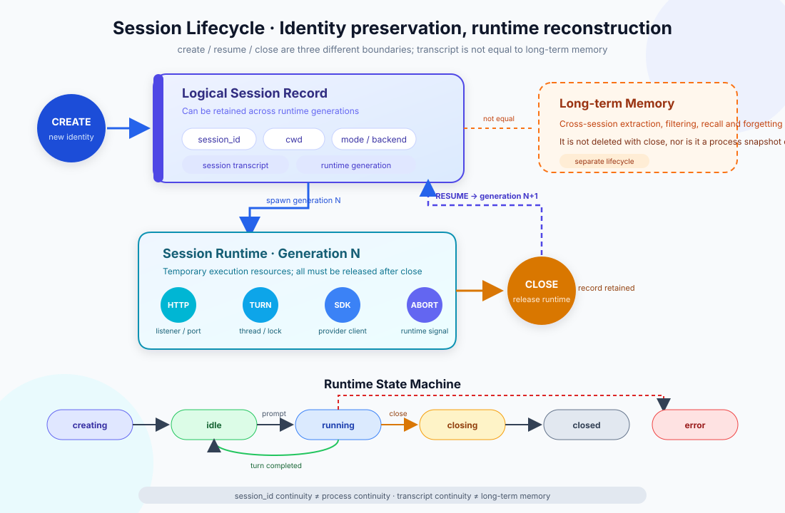
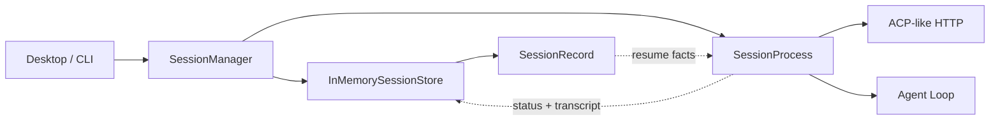

# s07: Session Management - Restore the Logical Session, Rebuild the Runtime

[中文](README.md) · [English](README.en.md)
> *A session identity can survive a runtime; processes, ports, locks, and clients cannot.*
>
> **Harness layer: session lifecycle, runtime isolation, and recovery boundaries.**

Create, close, resume, and forget are separate operations. Resume reconstructs runtime resources from durable session facts.



## Code Architecture Diagram



## What s07 Adds on Top of s06

s06 separated the desktop main process from the Sidecar and answered "who hosts the Agent". This chapter splits one level further down and answers "how does the Sidecar manage multiple independent work sessions".

s07 no longer reduces a session to one row in a process table. It explicitly separates two kinds of objects:

| Object | Lifetime | Contains | Must not contain |
|---|---|---|---|
| `SessionRecord` | Can survive across runtimes | Session ID, cwd, mode, backend, transcript, generation | Threads, ports, HTTP server, locks, provider client |
| `SessionProcess` | One runtime generation | HTTP listener, threads, abort signal, turn lock, execution entry point | Cross-session memory or permanent identity |

This split determines the recovery semantics: **resume does not revive the old process; it uses the old record to create a new runtime.**

## Learning Goals

After this chapter, you should be able to explain the following five questions:

1. Why are "the session still exists" and "the session process is still alive" two different things?
2. What do `create`, `resume`, `close`, and `forget` each change?
3. Why can ports, threads, locks, and provider clients not be persisted and then restored directly?
4. What is the difference between a session transcript and long-term memory?
5. Why can `running` shown in the UI not, on its own, serve as proof that a process is alive?

## Four Lifecycle Operations

### Create: Create the Identity and the First Runtime

`create_session()` first validates cwd, mode, and backend, then creates a new `SessionRecord`. Only after the record is written to the store does the Manager start the first-generation `SessionProcess`.

```text
validate request
      ↓
allocate session_id
      ↓
store SessionRecord(status=creating, generation=1)
      ↓
start SessionProcess
      ↓
publish idle
```

If the runtime fails to start, the logical record does not silently disappear; it keeps `error` and `last_error`. The UI can then explain the failure, and the user can close and resume after fixing the environment.

### Close: Release the Runtime, Keep the Session History

The job of `close_session()` is to reclaim the current runtime generation:

1. Switch the status to `closing`;
2. Ask the running turn to interrupt cooperatively;
3. Stop the HTTP server and close the listener;
4. Clean up thread and port references;
5. Publish `closed`, keeping the record and transcript.

Close is idempotent. Closing an already closed logical session again does not delete history and does not produce a second error.

### Resume: Create a New Runtime with the Old Identity

`resume_session()` loads an existing `SessionRecord`, increments `runtime_generation`, re-enters `creating`, and then allocates a new HTTP server, threads, port, and provider client.

```text
SessionRecord(session_id=sess_0001, generation=1, closed)
                           │
                           │ resume
                           ▼
SessionProcess(session_id=sess_0001, generation=2, new runtime)
```

What stays the same after resume is the logical identity, cwd, mode, backend, and transcript; what must be rebuilt is the process-level resources. If the same session id already has a live runtime, resume refuses to create a second one, so two executors never rewrite the same session history at once.

### Forget: Explicitly Delete the Logical Session

`forget_session()` is the operation that actually deletes the record, and it requires the runtime to be closed first. Keeping close and forget separate avoids losing history by accident when the user merely closes a window or restarts the app.

| Operation | Keeps session ID | Keeps transcript | Keeps runtime | Can resume |
|---|---:|---:|---:|---:|
| create | Yes | Creates an empty record | Yes | Not applicable |
| close | Yes | Yes | No | Yes |
| resume | Yes | Yes | Creates a new runtime | Yes |
| forget | No | No | No | No |

## State Machine

This chapter uses the following six states:

| State | Meaning | Main allowed next states |
|---|---|---|
| `creating` | Runtime resources are being allocated | `idle`, `error`, `closing` |
| `idle` | Runtime is ready for input | `running`, `closing`, `error` |
| `running` | One turn is executing | `idle`, `closing`, `error` |
| `closing` | Runtime is being interrupted and released | `closed`, `error` |
| `closed` | No live runtime; the record remains | Manager resumes it as a new `creating` generation |
| `error` | Current generation failed and recorded a reason | `closing`, then resume |

`SessionProcess._transition()` checks legal transitions in one place, so the HTTP handler, CLI, and Manager do not each change status strings on their own. A turn can only enter `running` from `idle`; the turn lock rejects concurrent input to the same session.

Note in particular: `idle` or `running` in a persisted record is the last observation, not an operating-system-level liveness proof. After an app crash, an old record may still show `running` while the old process no longer exists. Recovery must rely on whether the Manager currently owns a live runtime, and must create a new generation.

## Transcript Is Not Long-Term Memory

These two concepts are often mixed up because both "store past content", but they solve entirely different problems:

| Dimension | Session transcript | Long-term memory |
|---|---|---|
| Scope | One session ID | User, workspace, or organization |
| Main use | Continue protocol context | Recall useful information in a new task |
| Write path | Append messages and tool results by turn | Extract, filter, deduplicate, merge, or forget |
| Read path | Sequential read or recent window | Query, filter, rank, RAG, or policy selection |
| Lifetime | May remain after close; deleted by forget | Should not disappear when one session closes |
| Main risk | Context growth and protocol integrity | Relevance, staleness, contamination, scope leakage |

So what this chapter restores is **session continuity**, not cross-session "remembering the user". Later Memory chapters handle extraction and recall; RAG chapters handle retrieving evidence from external knowledge sources. Even if all three end up in the same Agent prompt, they should keep distinct data sources, scopes, and lifetimes.

## Why Only InMemorySessionStore Is Provided

This chapter adds no SQLite or JSONL backend. The role of `InMemorySessionStore` is to fix the interface boundary and let tests inject the same store into two different `SessionManager` instances: after the first Manager closes, the second Manager can load the record and resume.

```python
store = InMemorySessionStore()

manager_v1 = SessionManager(store)
sid = manager_v1.create_session("/workspace")
manager_v1.shutdown_all()       # close the runtime only

manager_v2 = SessionManager(store)
manager_v2.resume_session(sid)  # same ID, new generation
```

This proves the recovery protocol without pretending to be disk persistence. A production adapter usually also has to handle transactions, schema migration, concurrent writes, crash recovery, and transcript size control; these mechanisms should not be squeezed into one lightweight session-lifecycle lesson.

## ACP-Like HTTP Boundary

Each live `SessionProcess` tries to listen on a local port allocated atomically by the operating system. Binding directly with port `0` avoids the check-then-bind race of "find a free port first, bind it later".

```text
POST /agent/send      send a non-empty user message
GET  /agent/status    inspect current generation status and summary
POST /agent/abort     request cooperative interruption
GET  /agent/messages  read a JSON-safe transcript view
```

The HTTP handler only parses transport and maps errors; it does not write state directly. Every entry point delegates to `SessionProcess`, so the CLI, HTTP, and tests share the same state machine.

In a teaching sandbox that forbids socket bind, the runtime explicitly prints `socket binding unavailable` but can still demonstrate create/resume/close. This degradation is safe because the port is only an optional runtime capability, not the session identity. It never fakes an endpoint that does not actually exist.

## PTY and Pipe Belong to Runtime Configuration

| Feature | PTY | Pipe |
|---|---|---|
| Terminal semantics | Has a TTY; supports colors, cursor, and window size | Ordinary stdin/stdout/stderr |
| Signal behavior | Closer to an interactive terminal | Needs explicit process signals and protocol control |
| Suitable for | REPLs, interactive CLIs, and terminal UIs | Non-interactive tools and structured output |
| Recovery | Create a new PTY and worker | Create new pipes and a worker |

This chapter stores `backend` in the record so that resume can choose the same execution mode again; it does not mean a PTY file descriptor or pipe handle can be persisted.

To stay cross-platform, the current Python demo only uses `subprocess.run(..., capture_output=True)` to demonstrate command execution. The `pty` value is used to explain runtime selection and does not claim a full PTY implementation. A real PTY adapter must also handle resize, ANSI, foreground process group, and signal forwarding.

## Close and Abort Are Different

`abort()` only sets the cooperative interrupt signal of the current runtime; its goal is to stop one turn. It does not delete the record and does not close the listener automatically. `close()` ends the whole runtime generation and requests abort first when needed.

Provider calls in this chapter are synchronous, so abort cannot forcibly interrupt an SDK request that is blocking; it only takes effect at loop boundaries. A production Harness usually also needs provider cancellation, process signals, timeouts, and final forced reclamation. The README states this boundary explicitly, to avoid describing a `threading.Event` as a complete process-interruption mechanism.

## Code Walkthrough

### `SessionRecord`

Stores recoverable facts and outputs UI-safe metadata through `summary()`. The record has no `port`, server, thread, lock, or provider client.

### `InMemorySessionStore`

Protects create/save/load/list/delete with a lock and deep-copies at the boundary, so callers cannot bypass save and quietly modify shared records. It is a storage port, not a long-term memory store.

### `SessionProcess`

Owns all temporary resources of one runtime generation; it centrally executes state transitions, turn mutual exclusion, the provider loop, abort, and close. Every change to status or transcript is written back to the store through `record_sink`.

### `SessionManager`

It is the Sidecar control plane:

- `create_session()`: new id + generation 1;
- `resume_session()`: old id + generation incremented by one;
- `close_session()`: release the runtime, keep the record;
- `forget_session()`: delete a closed record;
- `shutdown_all()`: close all live runtimes without clearing the store.

## Test Coverage

`tests/test_session_lifecycle.py` uses a fake HTTP listener and needs no network permission. It covers:

- the logical record holds no port or server;
- create enters idle;
- a turn enters running while executing and returns to idle afterwards;
- close keeps the transcript;
- resume keeps the session id, creates a new runtime, and increments generation;
- after replacing the Manager, resume still works from the shared store;
- a live session cannot be resumed twice;
- close is idempotent, and forget must be explicit;
- a provider result returned only after close completes cannot overwrite the `closed` record;
- a provider failure is recorded as error and can be resumed after close.

## Run

Offline structure demo:

```bash
python3 s07_session_management/code.py --demo
```

Interactive lifecycle demo:

```bash
python3 s07_session_management/code.py
```

Suggested order to try:

```text
/sessions
/close sess_0001
/sessions
/resume sess_0001
/sessions
/forget sess_0001   # live state is rejected; close it first
```

## Common Mistakes

- **Treating a window or tab as the session.** The UI can be rebuilt; session identity should not depend on window objects.
- **Treating the port as session identity.** The port can change after resume; the session id is the logical identity.
- **Close equals delete.** This makes a normal exit or app restart lose history by accident.
- **Inferring a live process from database status.** `running` is only a record; combine it with the current runtime registry or a process probe.
- **Treating the transcript as memory.** A transcript can only continue its own session; it provides no cross-session filtering, scoping, or forgetting policy.
- **Serializing the whole runtime.** Threads, locks, sockets, and clients should be rebuilt, not revived by deserialization.
- **Two runtimes sharing one session id.** This causes transcript write races and out-of-order tool side effects.

## Exercises

1. Implement a SQLite adapter for `InMemorySessionStore` while keeping `SessionManager` unchanged.
2. Add startup reconciliation: mark `running` records left over from the last crash as recoverable.
3. Add a size cap and a compaction entry point to the transcript, and explain why it is still not long-term memory.
4. Implement a staged reclamation policy for close: "cooperative abort → timeout → forced termination".

## Next Lesson

s07 fixes session identity, runtime generation, and the recovery boundary. s08 adds model routing on top of this session runtime context: different tasks can choose different cost and capability tiers, but the routing result still belongs to the current runtime's execution configuration.

The original Chinese README remains the primary-language reference. This English companion keeps the same code, diagrams, local paths, and chapter structure so readers can switch languages without losing runnable details.

Local references:

- [Reference](README.md)
- [Reference](README.en.md)
- [Reference](./images/session-lifecycle-en.svg)
