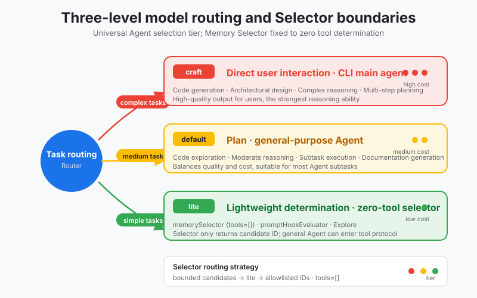
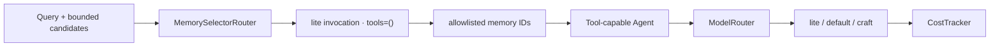

# s08: Model Routing - Use AI to Manage AI

[中文](README.md) · [English](README.en.md)
> *Let inexpensive models filter; reserve expensive models for reasoning and user-facing decisions.*
>
> **Harness layer: cost and latency control. A model is the agent's CPU.**

A small routing contract maps task roles to lite, default, or craft model tiers and keeps the Memory Selector tool-free.



## Code Architecture Diagram



## Prerequisites

- Model routing is a trade-off between cost, latency, and quality.
- Classification, filtering, and formatting suit light models; deep reasoning and final decisions suit strong models.
- Routing itself must also be observable; otherwise saving money turns into randomly degraded intelligence.
- The Memory Selector is an internal judge, not a general-purpose Agent that owns a tool loop.

## WorkBuddy-Style Mechanisms in This Chapter

- Abstracts the "use AI to manage AI" idea from public architecture research into three slot types: lite/default/craft.
- Gives auxiliary tasks and main reasoning tasks different model budgets.
- Records the reason for each route, for debugging and evaluation.

## Common Mistakes

- Routing every task to the strongest model lets cost spiral out of control.
- Routing every task to a cheap model makes the quality of key steps unstable.
- Routing only by keywords is easily misled by complex tasks.

## The Memory Selector's Separate Boundary

`memorySelector` and the `general-purpose` Agent both call a model, but they are not the same kind of runtime:

| Comparison | Memory Selector | General Tool Agent |
|---|---|---|
| Input | Query plus bounded retrieved candidates | User goal, context, and tool catalog |
| Output | Stable IDs from the candidate set | Text or a tool call |
| Tools | `tools=()`; schemas are rejected | Can discover, select, and execute tools |
| Side effects | None; produces one derived selection | May read files or call external systems |
| Failure handling | Drop unknown IDs, deduplicate, and cap the result | Handled by the tool protocol and permission layer |

Therefore the Memory Selector does not query the database, does not call `read_file`, and does not answer the user's question directly. The S12 Recall stage produces the candidates first; S08 only decides which model those candidates are routed to and guarantees that the selection call has no tool capability. This keeps candidate content from luring the internal selector into acting beyond the retrieval boundary.

In the code, `MemorySelectorRouter` exposes the single selector entry point:

```python
request = MemorySelectionRequest(
    query="previous login decision",
    candidates=candidates,
    limit=3,
)
result = MemorySelectorRouter(router).select(request)

assert result.route.model.tier is ModelTier.LITE
assert result.route.tools == ()
```

The offline mock only proves the route, zero-tool, and ID allowlist contracts; it does not claim to simulate real semantic relevance. Candidate generation, score, stable rank, and no-result semantics belong to the later Recall chapter.

## The Problem

s10 covered several kinds of Agent: the CLI main Agent, Explore, Plan, compact, memorySelector, promptHookEvaluator... each Agent has its own job.

But there is a question here: **should they all use the same model?**

Suppose you run every task on the most expensive Claude-4.0-Sonnet (about $15/M tokens):

- memorySelector needs to pick 3 relevant memories out of 50 - that is simple classification; does it need a $15/M model?
- promptHookEvaluator judges whether one hook output is safe - that is a yes/no decision; does it need a $15/M model?
- Explore searches the codebase for files - that is grep plus a summary; does it need a $15/M model?
- The CLI main Agent talks with the user directly - this one really does need the strongest model.

In one conversation, 5-10 sub-Agents may run in the background. If they all use the most expensive model, one conversation costs $0.5+, and 100 conversations a day cost $50+. More importantly, **stuffing many low-difficulty tasks into a high-capability model actually lowers context quality** - the model is flooded with boring classification tasks and its reasoning depth is diluted.

---

## The Solution

**Tiered model routing**: instead of using the same model for every task, route each task by difficulty to a different cost tier.

```
┌──────────────────────────────────────────────────────────────┐
│                     ModelRouter                               │
│                                                              │
│   Task arrives → assess difficulty → route to the matching tier                         │
│                                                              │
│   ┌──────────┐  ┌──────────────┐  ┌──────────────┐          │
│   │  lite    │  │   default    │  │   craft      │          │
│   │  (cheap)   │  │   (medium)     │  │   (expensive)       │          │
│   │          │  │              │  │              │          │
│   │ $0.25/M  │  │  $3/M        │  │  $15/M       │          │
│   │ coarse filtering/classification │  │  planning/execution    │  │  user interaction     │          │
│   └──────────┘  └──────────────┘  └──────────────┘          │
│      ▲               ▲                 ▲                     │
│      │               │                 │                     │
│  memorySelector    Plan             CLI Main Agent              │
│  promptHookEval    general-purpose   (directly faces the user)            │
│  Explore           compact                                    │
│                                                              │
└──────────────────────────────────────────────────────────────┘
```

| Tier | Role | Cost | Typical use |
|------|------|------|---------|
| **lite** | Filtering, classification, and screening | ~$0.25/M | Memory selection, hook evaluation, search |
| **default** | Planning, execution, and compaction | ~$3/M | General tasks, planning, context compaction |
| **craft** | Reasoning and user interaction | ~$15/M | Main CLI agent and complex reasoning |

Core principle: **cheap models do the coarse filtering, expensive models do the reasoning**.

---

## Model Matrix

WorkBuddy's `product.json` defines 12+ available models that cover different vendors, capabilities, and price points:

| Model ID | Name | Context window | Max output | Features | Typical use |
|----------|------|-----------|---------|---------|---------|
| `default` | Default | 200K | 24K | Tool calling | Main Agent default |
| `deepseek-v4-pro` | Deepseek-V4-Pro | 1M | 50K | Reasoning + vision | Long-context reasoning |
| `glm-5.0-turbo` | GLM-5.0-Turbo | 200K | 48K | Agent optimized | Agent tasks |
| `glm-5v-turbo` | GLM-5v-Turbo | 200K | 38K | Native multimodal | Vision tasks |
| `hunyuan-2.0` | Hunyuan-2.0 | 128K | 16K | Reasoning + vision | Tencent model |
| `default-1.2` | Claude-4.0-Sonnet | 200K | 24K | Reasoning + vision | High-quality reasoning |
| `codewise-*` | Code family | - | 256 | Code completion | IDE completion |
| **`lite`** | Lightweight tier | - | - | Cost optimization | **Pre-screening** |

A few key details:

- **`lite`** is not a specific model but a **cost tag** - it tells the routing layer "use the cheapest one"
- **`default`** is the main Agent's default choice, balancing capability and cost
- **`craft`** is the tag of the CLI main Agent; it faces user interaction and needs the strongest capability
- Reasoning models support the `effort` (low/medium/high) and `summary` (auto) parameters

---

## How It Works

### Model Tiers: lite / default / craft

```
Capability/cost axis:

Low cost ──────────────────────────────────────────── High cost
  │                                                    │
  │   lite              default             craft      │
  │   $0.25/M           $3/M                $15/M      │
  │   coarse filtering/classification          planning/execution            reasoning/interaction   │
  │                                                    │
  │   ◄── weaker capability                          stronger capability ──►   │
  │   ◄── low latency                          high latency ──►   │
  │   ◄── more concurrency                          less concurrency ──►   │
```

The logic behind the three tiers:

| Tier | Selection rule | Latency | Concurrency |
|------|---------|------|------|
| lite | Simple task, short output, no reasoning chain | Low | High |
| default | Context understanding and multi-step execution | Medium | Moderate |
| craft | Deep reasoning and direct user interaction | High | Low |

### Agent-Model Mapping

Each of the several kinds of Agent from s10 is bound to a model tier:

| Agent | Model tier | Reason |
|-------|------------|--------|
| CLI (main) | craft | Direct user interaction needs the strongest capability |
| general-purpose | default | General subtasks need tools and multiple steps |
| Explore | lite | Repository search and filtering need little deep reasoning |
| Plan | default | Architecture planning needs code understanding |
| compact | default | Context compaction must understand the conversation |
| contextSummary | default | Emergency summaries need understanding |
| memorySelector | lite | Select relevant records from memory |
| promptHookEvaluator | lite | Short safety decision |
| contentAnalyzer | lite | Classification |
| terminalTitleGenerator | lite | Very short output |
| summaryGenerator | lite | Compression task |
| insightsAnalyzer | lite | Lightweight analysis |
| agentInstructions | default | Agent instruction handling |
| fork | default | Child process with tool calls |
| statusline-setup | default | Status configuration |
| Bash | default | Bash execution with tools |

The pattern: **internal Agents that run in the background mostly use lite, user-facing ones use craft, and the ones in between use default**.

### The "Use AI to Manage AI" Philosophy

This is WorkBuddy's most central cost-optimization idea.

**Traditional approach**: stuff every memory, every tool, and all the code into the main Agent's context.

```
User: "What was the plan for fixing that bug last time?"
         │
         ▼
┌─────────────────────────────┐
│     Main Agent (craft)         │
│                             │
│  Context:                     │
│  - 50 memories (all)          │  ← 90% irrelevant
│  - 35 tool definitions             │  ← most are unnecessary
│  - 10 file contents             │  ← most are irrelevant
│  - User question                  │
│                             │
│  → search through a junk pile          │
│  → use an expensive model for low-value work        │
└─────────────────────────────┘
Cost: 50K tokens × $15/M = $0.75
```

**WorkBuddy approach**: first use the cheap lite model for coarse filtering, then use the expensive model on the filtered result.

```
User: "What was the plan for fixing that bug last time?"
         │
         ▼
┌─────────────────────────────┐
│  memorySelector (lite)       │  ← Step 1: coarse filter
│                             │
│  Input: 50  memories + User question   │
│  Output: 3 relevant memory IDs        │  ← select only 3
│                             │
│  Cost: 5K tokens × $0.25/M  │
│       = $0.00125            │
└──────────┬──────────────────┘
           │ 3 memories
           ▼
┌─────────────────────────────┐
│     Main Agent (craft)         │  ← Step 2: reasoning
│                             │
│  Context:                     │
│  - 3 relevant memories              │  ← all relevant
│  - User question                  │
│                             │
│  → reason deeply over the selected content       │
└─────────────────────────────┘
Cost: 5K tokens × $15/M = $0.075

Total cost: $0.00125 + $0.075 = $0.076
Compared with loading everything: $0.75 → saved 90%
```

**Core insight**: instead of feeding all information to the expensive model, let the cheap model filter first and let the expensive model see only the filtered result. Cost drops by an order of magnitude, and context quality actually improves.

This pattern recurs throughout WorkBuddy:

| Scenario | What lite does | What craft/default does |
|---|---|---|
| Memory retrieval | Select 3 records from 50 | Answer using the selected records |
| Hook evaluation | Decide whether output is safe | Show the result when safe |
| Code exploration | Search for relevant files | Read and understand file contents |
| Context compaction | Mark important passages | Generate the compact summary |

### The effort Parameter (low/medium/high)

Reasoning models (such as deepseek-v4-pro and hunyuan-2.0) support an `effort` parameter that controls reasoning depth:

| Effort | Behavior | Typical use |
|--------|------|---------|
| `low` | Fast answer with little reasoning | Simple questions and status checks |
| `medium` | Balanced reasoning and speed | General tasks |
| `high` | Deep reasoning | Complex architecture and difficult bugs |

```python
# Same model, different effort
response = client.messages.create(
    model="deepseek-v4-pro",
    effort="high",        # ← reasoning depth
    summary="auto",       # ← automatically summarize the chain of thought
    messages=messages,
)
```

This amounts to one more level inside a model tier: with the same craft model, low effort can come close to the cost of default, and only high effort is truly "all-out".

### auto Mode: Automatic Selection

Besides specifying `lite`/`default`/`craft` by hand, WorkBuddy also supports an `auto` mode - the system picks the best model automatically.

```
Simplified auto-routing logic:

Assess task complexity
    │
    ├── Simple (classification/search/filtering) ──► lite
    ├── Medium (planning/execution/compaction) ──► default
    └── Complex (reasoning/user interaction)   ──► craft
```

In the real implementation, `auto` decides based on task type, context length, and historical call patterns. But WorkBuddy's default strategy is more conservative - most Agents bind a model tier explicitly and do not rely on auto.

---

## Cost Estimate

Take a typical conversation as an example. The user asks, "Take a look at this project's architecture, then fix the login bug in src/auth.py":

### All-Craft Plan (No Tiering)

| Step | Agent | Tokens | Model | Cost |
|------|-------|--------|-------|------|
| 1 | Explore (file search) | 8K | craft | $0.12 |
| 2 | Plan (architecture analysis) | 15K | craft | $0.225 |
| 3 | memorySelector (memory search) | 5K | craft | $0.075 |
| 4 | promptHookEvaluator (hook) | 2K | craft | $0.03 |
| 5 | CLI (bug fix) | 20K | craft | $0.30 |
| **Total** | | **50K** | | **$0.75** |

### Tiered Routing Plan

| Step | Agent | Tokens | Model | Cost |
|------|-------|--------|-------|------|
| 1 | Explore (file search) | 8K | lite | $0.002 |
| 2 | Plan (architecture analysis) | 15K | default | $0.045 |
| 3 | memorySelector (memory search) | 5K | lite | $0.00125 |
| 4 | promptHookEvaluator (hook) | 2K | lite | $0.0005 |
| 5 | CLI (bug fix) | 20K | craft | $0.30 |
| **Total** | | **50K** | | **$0.349** |

**Savings: 53%**. On top of that, the lite model has lower latency, so the user also waits less.

With 100 conversations a day:
- All craft: $75/day → $2,250/month
- Tiered routing: $35/day → $1,050/month
- **$1,200 saved per month**

---

## WorkBuddy Architecture Comparison

### product.json — Model Registry

WorkBuddy defines its models in `product.json`; each model includes a context window, an output limit, and feature tags:

```json
{
  "models": [
    {
      "id": "default",
      "name": "Default",
      "contextWindow": 200000,
      "maxOutput": 24000,
      "features": ["tool_calling"]
    },
    {
      "id": "default-1.2",
      "name": "Claude-4.0-Sonnet",
      "contextWindow": 200000,
      "maxOutput": 24000,
      "features": ["reasoning", "vision"]
    },
    {
      "id": "lite",
      "name": "Lightweight",
      "features": ["cost_optimization"]
    }
  ]
}
```

### Model Tag Routing

WorkBuddy does not route by model ID directly; it routes by **tag**:

```javascript
// Specify a model label in the Agent definition, not a specific model ID
const AgentDefinitions = {
    CLI:              { model: "craft"   },  // label
    GENERAL_PURPOSE:  { model: "default" },
    EXPLORE:          { model: "lite"    },
    PLAN:             { model: "default" },
    COMPACT:          { model: "default" },
    MEMORY_SELECTOR:  { model: "lite"    },
    PROMPT_HOOK_EVAL: { model: "lite"    },
    // ...
};

// Resolve the label to a concrete model ID at runtime
function resolveModel(tag) {
    // "craft"   → user-configured craft model (such as Claude-4.0-Sonnet)
    // "default" → user-configured default model
    // "lite"    → user-configured lite model
    return userConfig.modelMapping[tag];
}
```

This tag mechanism lets users swap the underlying model flexibly - switching craft from Claude to GLM only requires a configuration change, not a code change.

### effort and summary Parameters

Reasoning models have `effort` and `summary` injected at API call time:

```javascript
// Inject reasoning-model parameters
function buildModelParams(model, agentConfig) {
    const params = { model: resolveModel(agentConfig.model) };

    if (model.features.includes("reasoning")) {
        params.reasoning = {
            effort: agentConfig.effort || "medium",
            summary: agentConfig.summary || "auto",
        };
    }

    return params;
}
```

---

## Code Walkthrough

`code.py` implements a complete model-routing demo:

1. **ModelTier enum** — defines the three tiers LITE / DEFAULT / CRAFT
2. **ModelInfo data class** — the cost, latency, and capability parameters of each model
3. **ModelRouter class** — routes an ordinary Agent name to its tier and records the cost
   - `route_request(agent_name)` → returns ModelInfo
   - `call_model(model, prompt)` → performs the mock call after routing is done
   - `CostTracker` → accumulates tokens and cost per tier
4. **MemorySelectorRouter** — receives bounded candidates, fixes `tools=()`, and returns only allowlisted IDs
5. **"Use AI to manage AI" demo** — the lite selector first picks 3 IDs out of 10 candidates, and the craft model sees only those three records
6. **Cost comparison** — the all-craft plan vs the tiered routing plan, printed as a comparison table
7. **Agent loop** — simulates one complete conversation, showing the runtime difference between the selector and a general-purpose Agent

Key code:

```python
# Routing table: Agent → model tier
AGENT_MODEL_MAP = {
    "CLI":                   ModelTier.CRAFT,
    "general-purpose":       ModelTier.DEFAULT,
    "Explore":               ModelTier.LITE,
    "Plan":                  ModelTier.DEFAULT,
    "compact":               ModelTier.DEFAULT,
    "memorySelector":        ModelTier.LITE,
    "promptHookEvaluator":   ModelTier.LITE,
}

def route_request(self, agent_name: str) -> ModelInfo:
    tier = AGENT_MODEL_MAP.get(agent_name, ModelTier.DEFAULT)
    return self.models[tier]
```

---

## Run

```bash
python s08_model_routing/code.py
```

No API key is needed - all LLM responses are mocked. What to watch:

1. **Routing table**: is each Agent routed to the correct model tier?
2. **"Use AI to manage AI" demo**: does the selector always go through lite, keep `tools=()`, and output only IDs from the candidate set?
3. **Cost comparison**: how much does tiered routing save compared with all-craft?
4. **Agent loop**: in one conversation, how many times is lite used, how many times default, and how many times craft?

---

## Exercises

Use these exercises to change one part of model selection, effort levels, and cost-aware routing at a time and explain the resulting contract.

## Next Lesson

Model routing is in place: each kind of Agent uses its own model tier. But once a conversation ends, it is gone - the next time you open the same project, everything discussed before is forgotten. s09 covers conversation persistence - a JSONL append-only log, 6 event types, and crash recovery.

s09 JSONL Transcript → append-only writes, event replay, crash recovery.

The original Chinese README remains the primary-language reference. This English companion keeps the same code, diagrams, local paths, and chapter structure so readers can switch languages without losing runnable details.

Local references:

- [Reference](README.md)
- [Reference](README.en.md)
- [Reference](./images/model-routing-en.svg)
