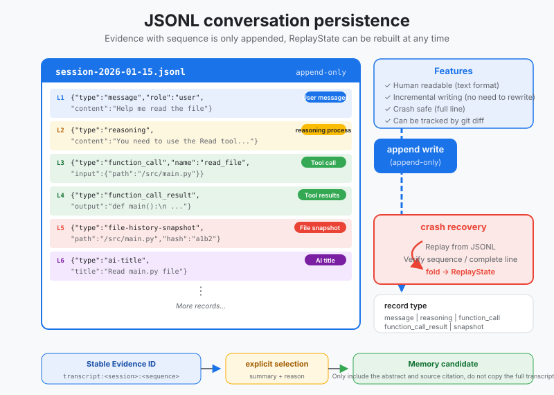
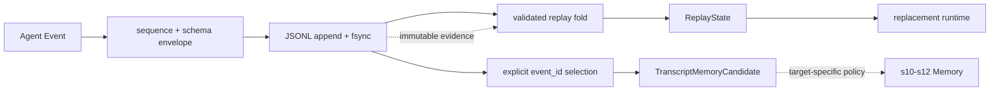

# s09: JSONL Transcript - Append Evidence and Rebuild Runtime State

[中文](README.md) · [English](README.en.md)
> *The transcript is evidence; replay state is derived from that evidence.*
>
> **Harness layer: persistence and crash recovery.**

Append-only JSONL records every session event, supports bounded replay, and keeps transcript evidence separate from long-term memory.



## Code Architecture Diagram



## Prerequisites

The lesson assumes a session can emit structured events and focuses on append-only persistence, tail recovery, and replay.

## WorkBuddy-Style Mechanisms in This Chapter

The lesson treats the transcript as an append-only event record that can be inspected and recovered after interruption.

## Common Mistakes

A transcript should not silently become long-term memory, and partial writes must not be mistaken for complete events.

## The Problem

The harness needs durable conversation history without coupling event recovery to the semantics of user or workspace memory.

## The Solution

```
┌──────────────────────────────────────────────────────────────────┐
│                      Session Process                              │
│                                                                  │
│   messages[] (in-memory)                                         │
│       │                                                          │
│       │ every event → append                                     │
│       ▼                                                          │
│   ~/.workbuddy/projects/<workspace>/<session>.jsonl              │
│   ┌────────────────────────────────────────────────┐            │
│   │ {"type":"message","role":"user","content":"..."}│  line 1   │
│   │ {"type":"reasoning","content":"Let me analyze"} │  line 2   │
│   │ {"type":"function_call","name":"read_file",...} │  line 3   │
│   │ {"type":"function_call_result","callId":"...",..}│  line 4   │
│   │ {"type":"file-history-snapshot","path":"main.py"}│  line 5   │
│   │ {"type":"message","role":"assistant","content":.}│  line 6   │
│   │ {"type":"ai-title","title":"Fix login bug"}     │  line 7   │
│   │ ...                                             │  (grows)  │
│   └────────────────────────────────────────────────┘            │
│       │                                                          │
│       │ crash? just read the file                                │
│       ▼                                                          │
│   replay(max_items=1000) → messages[] restored                   │
└──────────────────────────────────────────────────────────────────┘
```

## How It Works

### JSONL File Structure

Each session maps to one `.jsonl` file:

```
~/.workbuddy/projects/
  ├── myproject/
  │   ├── session_abc123.jsonl    ← this conversation
  │   ├── session_def456.jsonl    ← the previous conversation
  │   └── session_ghi789.jsonl
  └── another-project/
      └── session_xyz000.jsonl
```

Each line is an independent JSON object separated by `\n`. There is no outer array and no file header. The first line is the first event, and the last line is the newest event.

### Six Event Types

| JSONL `type` | Purpose | Corresponding LLM `messages[]` |
|--------------|------|---------------------|
| `message` | User or assistant message | `{"role": "user/assistant", "content": "..."}` |
| `reasoning` | Reasoning metadata | No direct mapping |
| `function_call` | Tool invocation | `tool_use` block in an assistant message |
| `function_call_result` | Tool result | `tool_result` block in a user message |
| `file-history-snapshot` | File-state snapshot | No mapping; used for file tracking |
| `ai-title` | Generated session title | No mapping; session metadata |

Example JSONL content:

```jsonl
{"schema_version":1,"sequence":1,"session_id":"abc123","event_id":"transcript:abc123:1","recorded_at":"...","type":"message","role":"user","content":"fix the bug"}
{"schema_version":1,"sequence":2,"session_id":"abc123","event_id":"transcript:abc123:2","recorded_at":"...","type":"reasoning","content":"Let me analyze the error..."}
{"schema_version":1,"sequence":3,"session_id":"abc123","event_id":"transcript:abc123:3","recorded_at":"...","type":"function_call","name":"read_file","arguments":{"path":"main.py"},"callId":"call_001"}
{"schema_version":1,"sequence":4,"session_id":"abc123","event_id":"transcript:abc123:4","recorded_at":"...","type":"function_call_result","callId":"call_001","output":{"content":"..."}}
```

The first three types (message, reasoning, function_call) are the three stages of the agent's chain of thought: the user asks → the model reasons → the model acts. The fourth (function_call_result) is the feedback from that action. The last two (file-history-snapshot, ai-title) are system-level metadata.

### Append-Only Writes

There is only one write operation: **append one line**. No updates, no deletes.

```python
def append(self, event: dict) -> None:
    envelope = {
        "schema_version": 1,
        "sequence": self.next_sequence(),
        "recorded_at": utc_now(),
        **deepcopy(event),
    }
    os.write(fd, (json.dumps(envelope) + "\n").encode())
    os.fsync(fd)
```

`O_APPEND` guarantees that each write starts at the current end of the file; a single `os.write` avoids multiple writers seeking to the same offset first. It does not promise "a whole line or nothing" across a power loss, so the reader must still handle an unterminated last line. `fsync` runs before a successful return, which keeps the durable boundary clear and testable.

That is what "append, never overwrite" means: **the file only grows, and existing lines never change**.

### Session Replay (replay <= 1000)

When a session loads, the whole JSONL file does not need to be read into memory. WorkBuddy sets a limit:

```
CODEBUDDY_SESSION_MAX_ITEMS = 1000
```

Replay strategy:

```
                    JSONL File (may be very long)
    ┌──────────────────────────────────────────────────────┐
    │ line 1   {"type":"message",...}                     │
    │ line 2   {"type":"reasoning",...}                   │
    │ ...                                                 │
    │ line 995  {"type":"message",...}                    │
    │ line 996  {"type":"function_call",...}   ──┐        │
    │ line 997  {"type":"function_call_result".. │        │
    │ line 998  {"type":"message",...}           │ read   │
    │ line 999  {"type":"reasoning",...}         │ last   │
    │ line 1000 {"type":"message",...}           │ 1000   │
    │ line 1001 {"type":"ai-title",...}   ──────┘        │
    │ ...                                                 │
    └──────────────────────────────────────────────────────┘
                            │
                            ▼
              replay(max_items=1000)
                            │
                            ▼
                reconstructed messages[]
                 (last 1000 events)
```

```python
def replay(self, max_items=1000):
    events = self._read_all_events()
    recent = events[-max_items:]  # Take last N events

    messages = []
    for event in recent:
        msg = self._event_to_message(event)
        if msg:
            messages.append(msg)
    return messages
```

Why 1000? A typical agent interaction (user message + reasoning + tool call + result + reply) is roughly 5-10 events. 1000 events ≈ 100-200 interaction rounds, which covers the vast majority of sessions. Very long sessions load only the most recent context, so the whole history is not stuffed into the LLM's context window.

### Crash Recovery

```
1. Session process crashes
       │
       ▼
2. On restart: open <session>.jsonl
       │
       ▼
3. Read backwards (last N items)
       │
       ▼
4. Reconstruct messages[] from events
       │
       ▼
5. Resume agent loop
```

```python
def recover(self):
    events = self._read_all_events()
    messages = self.replay()

    # Also recover metadata
    title = None
    file_snapshots = []
    for event in events:
        if event.get("type") == "ai-title":
            title = event.get("title")
        elif event.get("type") == "file-history-snapshot":
            file_snapshots.append(...)

    return {
        "messages": messages,
        "title": title,
        "file_snapshots": file_snapshots,
        "total_events": len(events),
    }
```

The key to crash recovery: **JSONL is immutable evidence, and `ReplayState` is derived state obtained by folding over that evidence.** A new process does not deserialize the old process's clients, locks, ports, or abort flags; those resources must be created again.

### Why Corruption Keeps Only a Partial Tail

A last line that has no trailing newline and contains incomplete JSON usually means the process exited in the middle of an append; it can be ignored and reported as `ignored_partial_tail=True`. A last line with complete JSON but no `\n` is not a partial tail: it is still counted during replay, and `ignored_partial_tail` stays `False`, but appending is not allowed either. A bad line in the middle, a complete bad line, or a gap in `sequence` all mean the evidence chain can no longer be trusted, so the reader raises `TranscriptCorruptionError` instead of quietly continuing.

Read-only recovery does not mean the original file may keep receiving appends. `append()` first re-reads the log; if it finds a partial tail as described above, or the file is non-empty and its last byte is not `\n` (judged on raw bytes; a trailing `\r` or only whitespace also counts), it raises `TranscriptCorruptionError` before opening the file for appending, and the original file bytes stay unchanged. Otherwise the new JSON would be glued directly onto the broken content or the previous record, turning an ignorable tail into a complete bad line and making later replays fail. The caller should keep the old log and switch to a new transcript file; this example does not automatically truncate, add a newline, copy history, or migrate the session.

This check applies to the current read result, and when the file does not exist it clears any previously observed partial-tail flag; it does not provide mutual exclusion between multiple writers, and it cannot guarantee that another process will not modify the file after the check. A normal, complete log still appends with the next sequence number.

### Transcript Is Not Memory

A transcript stores what happened, per session, with the goal of being faithful and replayable; s10 Workspace Memory selects stable project facts across sessions, with the goal of relevance and long-term retention. Closing the runtime does not delete the transcript, and replay does not automatically promote the transcript into memory.

### Transcript to Memory Requires Explicit Selection

`replay(max_items=N)` only decides how many recent events this turn's prompt can see; it cannot serve as a long-term retention policy. Even if an old event is no longer inside the replay window, the Memory policy can still reference it precisely through its stable `event_id`; conversely, appearing in replay does not mean an event should be saved as Memory.

The teaching version writes the conversion boundary as `select_memory_candidate(event_id, summary, reason)`:

| Condition | Reason |
|------|------|
| Must reference a fully persisted `event_id` | Memory can trace it to one session and sequence |
| Must include a summary and selection reason | Retention is an explainable decision, not a history copy |
| Only `message` and `file-history-snapshot` may be promoted | Reasoning, tool calls, tool bodies, and titles do not promote directly |
| Candidate carries no source event body | Large results remain owned by transcript/artifact storage |
| s10-s12 apply their own target-domain policy | Workspace, user, and remote memory have different scopes |

```python
candidate = transcript.select_memory_candidate(
    "transcript:session_abc123:17",
    summary="The project will use SQLite WAL.",
    reason="A persistence architecture decision explicitly confirmed by the user.",
)

# candidate.source_metadata() can be passed to the later Memory layer; it is not written to Memory here.
```

This boundary prevents two common mistakes: copying the whole transcript into "long-term memory", and stuffing all history back into the prompt when a session is restored.

---

## JSONL vs SQLite

WorkBuddy uses both JSONL and SQLite, but keeps their responsibilities strictly separate:

| Dimension | JSONL | SQLite |
|------|-------|--------|
| **Use** | Conversation content and source truth | Metadata and indexes |
| **Write mode** | Append-only | CRUD |
| **Recovery** | Replay the file | Backup and restore |
| **Query** | Sequential scan | SQL |
| **Content** | Messages, tool calls, and reasoning | Sessions, usage, and automations |
| **File** | One `.jsonl` per session | One `.db` file |
| **Concurrency** | One independent file per session | Connection pool and locks |
| **Schema** | Each line is independently parsed | Tables and migrations |

```
         Conversation content                          Metadata
         ────────                          ──────
    ┌──────────────┐              ┌──────────────────┐
    │ session.jsonl│              │   workbuddy.db   │
    │              │              │                  │
    │ message      │              │ sessions table   │
    │ reasoning    │              │  (id, title,     │
    │ function_call│              │   cwd, status)   │
    │ result       │              │                  │
    │ snapshot     │              │ usage_stats      │
    │ ai-title     │              │  (tokens, cost)  │
    │              │              │                  │
    │ (source of   │              │ automations      │
    │  truth)      │              │  (schedule, rrule│
    └──────────────┘              │   prompt)        │
                                  └──────────────────┘
```

**Principle**: data that can be rebuilt from JSONL is not stored in SQLite. SQLite stores only what "cannot be derived from the conversation stream", such as the session title (an `ai-title` is also in the JSONL, but SQLite stores the title after the user edits it manually) and automation schedules.

---

## Why JSONL

### 1. Simple

Append-only does not need a relational table's `ALTER TABLE`. New event types can keep appending with a new `schema_version` and fields; the reader preserves unknown events as evidence and ignores them only when building the derived views it understands, without rewriting old lines.

### 2. Crash Recovery

No extra transaction log is needed. The file itself is the log. After a crash, only a tail that "has no newline and contains incomplete JSON" may be ignored; a complete bad line, a bad line in the middle of the file, and a break in sequence/ID must all fail closed, so evidence corruption is never disguised as a successful recovery.

### 3. Portable

Plain text, one JSON per line. `cat session.jsonl | jq .` is enough to read it. `grep '"type":"function_call"' session.jsonl` filters tool calls. Need an export? `cp session.jsonl backup.jsonl`. Need a migration? Just copy the file.

### 4. Reverse Scan

You can read only the last N lines of the file to get recent context quickly. Linux `tail -n 1000` does exactly that. To do the same in a database you need `ORDER BY timestamp DESC LIMIT 1000`, and an index as well.

### 5. No Lock Contention

One file per session, written by one process. Session A can never lock session B. A database's table locks, row locks, and connection pool are unnecessary complexity in a single-session scenario.

---

## WorkBuddy Architecture Comparison

### File Location

```
~/.workbuddy/projects/<workspace>/<session_id>.jsonl
```

One directory per workspace, one `.jsonl` file per session. The file name is the session ID.

### Event Format

WorkBuddy's JSONL events carry quite a few more fields than the teaching version (streaming IDs, UUIDs, model information, and so on), but the core `type` field is the same:

```jsonl
{"type":"message","role":"user","content":"fix the bug","uuid":"a1b2c3","timestamp":1709123456}
{"type":"reasoning","content":"Let me analyze...","uuid":"d4e5f6","timestamp":1709123457}
{"type":"function_call","name":"read_file","arguments":{"path":"main.py"},"callId":"call_001","uuid":"g7h8i9"}
```

### Replay Limit

```javascript
const CODEBUDDY_SESSION_MAX_ITEMS = 1000;
```

When a session loads, at most 1000 events are read from the end of the JSONL file to rebuild `messages[]`. The rest is not loaded; if the user scrolls back to earlier history, it is read on demand.

### JSONL Write Timing

WorkBuddy writes JSONL at every key point of the agent loop:

```
User sends a message     → append message event
Model starts reasoning     → append reasoning event
Model calls a tool     → append function_call event
Tool returns a result     → append function_call_result event
File is modified       → append file-history-snapshot event
Session title is generated     → append ai-title event
```

Every `append` is one `fs.writeFileSync` (or a streaming write). No batching and no buffering: each event hits the disk immediately. This guarantees that a crash loses at most the one event being written.

---

## Code Walkthrough

`code.py` implements a complete JSONL session recording and recovery demo:

1. **`JSONLTranscript` class** — the core, wrapping append, replay, and recovery for the JSONL file
   - `append(event)` — append one JSON line, never overwrite
   - `replay(max_items=1000)` — take the most recent N events from the end and rebuild messages[]
   - `recover()` — read all events and restore messages[] plus metadata
   - `select_memory_candidate(event_id, summary, reason)` — explicitly select one traceable piece of evidence without copying its body
   - `_event_to_message(event)` — convert a JSONL event into the LLM message format

2. **`MockLLM` class** — a scripted mock LLM conversation that demonstrates all 6 event types

3. **`demo()` function** — a demo in three acts:
   - Part 1: the agent runs and every event is appended to JSONL
   - Part 2: a simulated crash clears the in-memory state
   - Part 3: recover from JSONL and rebuild the full state

---

## Run

```bash
python s09_jsonl_transcript/code.py
```

What to watch:

- In Part 1, how the JSONL line count grows after each event is appended (`jsonl line: N`)
- In Part 2, the in-memory state is cleared after the crash, but the JSONL file is still on disk
- In Part 3, whether the recovered messages[] matches Part 1
- The raw JSONL file printed at the end: one JSON per line, readable and greppable

---

## Exercises

1. **Truncated replay**: modify `replay()` so that, while reading backwards, it stops at the last `message` event with `role=user`. This restores only the context of the "last round of conversation" instead of the whole history.
2. **Corruption boundaries**: create an unterminated partial tail and a complete bad line that ends with a newline; verify that the former is reported and ignored while the latter raises `TranscriptCorruptionError`.
3. **Session sharding**: when a JSONL file exceeds 10000 lines, automatically create a new file (such as `session_abc123_2.jsonl`) and record the shard information in SQLite. Implement this sharding logic.

---

## Next Lesson

The conversation is stored, and the JSONL file keeps every message persisted on disk. But the agent forgets once the work is done: the next time you open the same project, it has no idea which bugs were fixed or why the changes were made. s10 covers workspace memory: a daily work log, appended and never overwritten.

s10 Workspace Memory → log appends, topic distillation, 30-day retention.

The original Chinese README remains the primary-language reference. This English companion keeps the same code, diagrams, local paths, and chapter structure so readers can switch languages without losing runnable details.

Local references:

- [Reference](README.md)
- [Reference](README.en.md)
- [Reference](./images/jsonl-transcript-en.svg)
