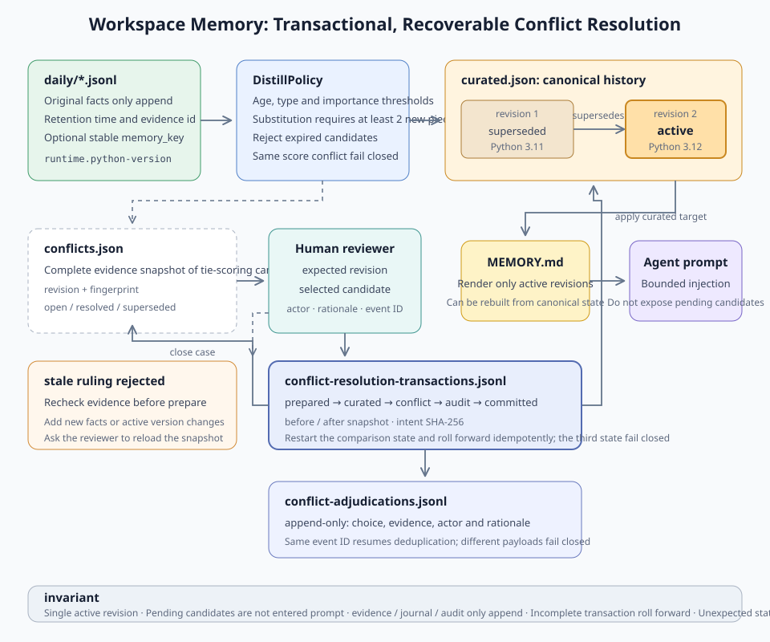
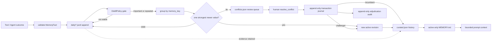
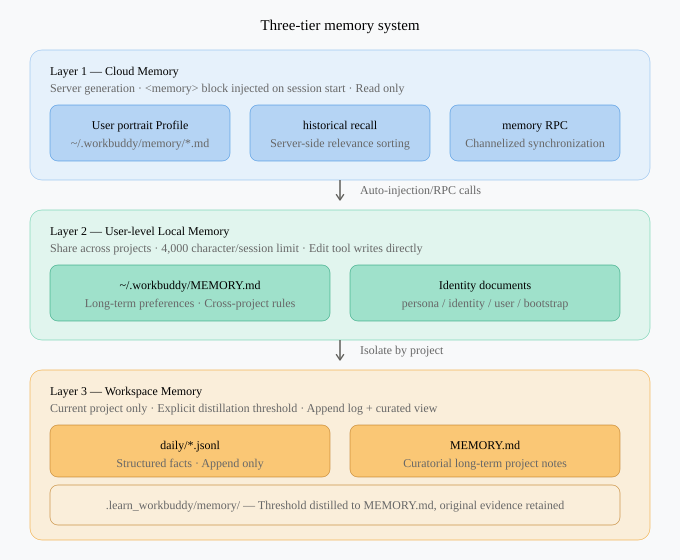
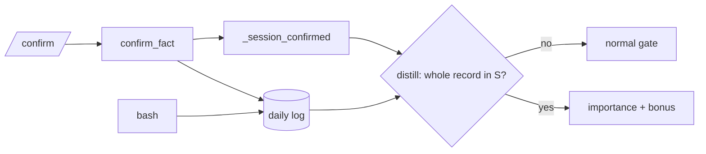

# s10: Workspace Memory - Turn Work Logs into Durable Project Facts

[中文](README.md) · [English](README.en.md)
> *Workspace memory records facts that belong to a project, not to a person or a single turn.*
>
> **Harness layer: scoped memory and durable project context.**

The lesson shows how to record, normalize, deduplicate, and recover project facts without treating every conversation sentence as memory.



## Code Architecture Diagram



## Design Goals of This Chapter

The s09 JSONL transcript belongs to one session and is the complete execution evidence. This chapter does not copy the chat log again; it builds selective, project-level memory:

- Different sessions of the same project can recover the same memory; different projects never cross over.
- Raw facts are append-only, and distillation never deletes evidence.
- Only facts that are stable, old enough, and important or repeated enter the long-term view.
- Replaceable project decisions use an explicit `memory_key` to form a conflict domain; a new value replaces the old one only when it is confirmed repeatedly and is newer.
- Superseded revisions and raw evidence are kept; the prompt only injects the active revision of each conflict domain.
- Conflicts of equal strength form a persisted review case; only an explicit human decision can choose a candidate.
- A decision is bound to the evidence fingerprint, the case revision, and the event ID; a stale page or a retry cannot overwrite newer evidence.
- A multi-file decision first writes an append-only transaction intent; after an exit at any write boundary, a restart rolls it forward idempotently.
- Curated state is updated by atomic replacement, so a failure still leaves the previous complete file.
- The memory policy can be verified without an API key.

This is also its main step beyond s09: **the transcript records faithfully; memory selects lossily.**

## Storage Layout and Ownership

```text
project/
└── .learn_workbuddy/
    └── memory/
        ├── daily/
        │   ├── 2026-08-07.jsonl
        │   └── 2026-08-08.jsonl
        ├── curated.json
        ├── conflicts.json
        ├── conflict-adjudications.jsonl
        ├── conflict-resolution-transactions.jsonl
        └── MEMORY.md
```

| File | Identity | Write method | Can serve as evidence |
|---|---|---|---|
| `daily/*.jsonl` | Raw fact log | One-record `O_APPEND` | Yes |
| `curated.json` | Machine truth for curated state | Temporary file + `os.replace` | Traceable to evidence IDs |
| `conflicts.json` | Pending and historical conflict snapshots | Temporary file + `os.replace` | Yes; keeps candidates, revisions, and fingerprints |
| `conflict-adjudications.jsonl` | Human adjudication audit stream | One-event `O_APPEND` | Yes; records actor, rationale, and selected evidence |
| `conflict-resolution-transactions.jsonl` | Multi-file adjudication recovery log | `O_APPEND` phase events | Yes; keeps the intent hash, before/after snapshots, and commit phase |
| `MEMORY.md` | Derived view for humans and the prompt | Rebuilt atomically from curated state | No; always rebuildable |

The teaching implementation uses the `.learn_workbuddy` namespace so exercise code never touches real product state. `WorkspaceMemory` first resolves the absolute project path and then derives a `workspace_id`; both the logs and the curated files check that id when they are read.

## How a Fact Enters Long-Term Memory

### 1. Record Structured Facts

`MemoryFact` does not accept a long free-form summary; it requires explicit fields:

```python
memory.append_daily_log(
    "SQLite must run in WAL mode.",
    kind=FactKind.DECISION,
    importance=5,
    memory_key="storage.sqlite.journal-mode",
    source="agent",
    evidence={"file": "storage.py"},
)
```

`kind` has only four types:

| Type | Example | Distilled by default? |
|---|---|---|
| `decision` | Choose SQLite WAL | Yes |
| `convention` | Paths must be relative to the workspace | Yes |
| `pitfall` | Never write tokens into memory | Yes |
| `outcome` | This test passed | No; keep it in the recent log |

Content, importance, and kind are validated before anything is persisted. Each JSON object is encoded as one line and appended with a single `os.write`; `fsync` runs before the call returns.

`memory_key` is an optional, stable conflict domain that the harness or the tool caller provides explicitly. It only allows lowercase words with `.`, `_`, and `-` separators, for example `runtime.python-version`. It describes "which question this memory answers", not the answer itself: `Use Python 3.11` and `Use Python 3.12` can share the same key. Older calls that do not set the field keep using a content-derived key; the upgrade never guesses or merges them.

### 2. Distill Through an Explicit Policy

The default policy works like this:

```text
age reaches 30 days
AND type is one of decision / convention / pitfall
AND (importance >= 4 OR reappears after normalization >= 2 times)
```

These rules deliberately do not let an LLM decide directly "what is worth remembering forever". A production system may use a model during candidate extraction, but the retention conditions, the scope, and the evidence relationships should still be controlled by the harness.

Curated memory without a `memory_key` still gets a stable key from `kind + normalized content`. Explicitly keyed memory first forms a conflict domain by `memory_key` and then follows these rules:

1. A new fact with the same content as the active one only merges `evidence_ids`; it does not create a new revision.
2. Different content must pass the normal promotion gate and also be confirmed by at least `supersession_repeat_threshold` independent facts; the default is 2, so even a single high-importance fact cannot directly overwrite an existing decision.
3. The newest time of the candidate must be later than the `last_seen` of the active revision; stale evidence cannot roll back the current value.
4. Multiple candidates are ranked by importance, number of independent pieces of evidence, and newest time; when the best scores tie, it fails closed, keeps the current revision, and creates a persisted `MemoryConflictCase`.
5. The single winner becomes the next active revision; the old one is marked `superseded`, and the two point to each other through `supersedes` / `superseded_by`.

Every revision keeps its `revision` and `evidence_ids`, so running `distill` repeatedly is idempotent and the full decision history can be audited. `DistillReport` also reports `superseded`, `conflicts`, `queued_conflicts`, `conflict_case_ids`, and `stale`, so the reason an overwrite was refused is observable.

### 3. Tied Conflicts Enter the Human Review Queue

A case is not a one-line "a conflict happened" notice; it is a complete, recoverable observation snapshot:

- `conflict_id`: generated deterministically from the workspace, the memory key, and the evidence fingerprint;
- `revision`: the case version for the same memory key;
- `candidates`: the current active incumbent and the tied challenger;
- `evidence_ids`: the immutable source set of each candidate;
- `observed_fact_ids`: all facts seen in that conflict domain at detection time;
- `active_entry_key`: the active curated revision at detection time;
- `open / resolved / superseded`: the case lifecycle.

Running `distill()` again does not create the same case twice. When the evidence changes and the candidates are still tied, the old open case is marked `superseded` and the new fingerprint forms the next revision. Callers can only get open cases through `list_conflicts()`; these candidates never enter `MEMORY.md` or the agent prompt.

### 4. Explicit Adjudication and Append-Only Audit

A decision must submit the case revision that was just seen:

```python
case = memory.list_conflicts()[0]
choice = next(c for c in case.candidates if c.content == "Use Postgres.")

event = memory.resolve_conflict(
    case.conflict_id,
    choice.candidate_id,
    expected_revision=case.revision,
    actor="reviewer@example.com",
    rationale="Production requires PostgreSQL extensions.",
    event_id="review:storage-database:42",
)
```

Before it runs, it checks again that:

1. the case is still open and its revision has not changed;
2. the current active entry is still the version seen at detection time;
3. the observed fact IDs of the current workspace match the fingerprint snapshot;
4. the selected candidate really belongs to the case;
5. the event ID has not been used for a different decision.

Any new evidence raises `StaleConflictResolutionError`, asking the reviewer to look at the candidates again. Choosing the challenger creates the next curated revision; choosing the incumbent only records "keep as is" and never creates a fake revision. After the checks pass, the harness first writes the complete decision intent to `conflict-resolution-transactions.jsonl` and then updates the canonical state. The success event is appended to `conflict-adjudications.jsonl` with the actor, rationale, case revision, selected evidence IDs, the original active key, and the resulting active key.

Retrying the same event ID with exactly the same arguments returns the original event without writing the audit again or creating a revision; reusing an event ID to choose a different candidate is explicitly refused. The adjudication API belongs only to trusted harness/human entry points; it is not in the model tool list of `MemoryAwareAgent`.

### 5. Preserve Raw Evidence

Distillation builds a derived view; it is not log cleanup:

```text
daily fact log ──select──> curated.json ──render──> MEMORY.md
       │                    │
       └──── retained ──────┘  evidence_ids
```

Deleting old logs would leave long-term conclusions without a source and make a wrong distillation impossible to recompute. Real storage cleanup belongs to a separate retention/backup policy and is not mixed with memory distill.

### 6. Atomic Updates, Transaction Journal, and Restart Recovery

Opening `MEMORY.md` directly with `"w"` can leave half a file behind if the process crashes. This chapter uses a temporary file in the same directory:

1. write the complete content;
2. `flush + fsync`;
3. atomically replace the target with `os.replace`; platforms that support directory handles also `fsync` the containing directory, while Windows safely skips directory sync that `os.open` does not support;
4. on failure, clean up the temporary file and leave the old version unchanged.

The Windows fallback still fully writes, flushes, and syncs the temporary file before the same-directory `os.replace`, so half a new file is never exposed as canonical state. POSIX platforms also sync the directory entry to strengthen rename durability after a power loss.

Atomic replacement of a single file cannot make three files one atomic transaction. One human decision has to update `curated.json`, close the case in `conflicts.json`, and append an audit record to `conflict-adjudications.jsonl`; finishing only some of these would leave project memory and the review/audit state contradicting each other.

So before any business side effect, `resolve_conflict()` first appends an intent with complete before/after snapshots to the transaction journal. It then advances step by step:

```text
prepared
  -> curated_applied
  -> conflict_closed
  -> audit_appended
  -> committed
```

Each phase first completes its target write and then appends a phase event with the same `transaction_id` and `intent_sha256`. If the process exits right after the target write but before the phase event is appended, a new `WorkspaceMemory(project_dir)` compares the disk state: if it still equals before, it redoes the step; if it already equals after, it continues; if it is neither before nor after, it fails closed as corrupted state. Audit events are deduplicated by the original event ID, so repeated recovery never creates duplicate revisions or audit lines. A modified journal intent, a skipped phase, or a workspace mismatch is also explicitly refused.

`curated.json` is the canonical memory state, `conflicts.json` is the canonical review queue state, and `MEMORY.md` is a rebuildable projection. If the process exits between replacing the curated state and the projection, the recovery transaction repairs the stale projection from the canonical state and then goes on to close the case and append the audit. Creating a new `WorkspaceMemory(project_dir)` instance is enough to recover an unfinished decision and then load facts, curated entries, conflict cases, the adjudication log, and the prompt context; it never depends on any object from the old process.

The current schema is v2; the reader still accepts v1 daily facts and curated state. Old entries are recovered with keyless legacy semantics and saved as v2 at the next successful distill write, without inferring conflict domains automatically. When keyed state is read, it also checks that each domain has exactly one active revision, that revision numbers are contiguous, and that the forward and backward links match; corrupted state raises an explicit error instead of silently picking an answer.

## Prompt Injection Boundary

`get_context_for_agent()` injects only two parts:

- the compact `MEMORY.md`;
- at most 6 recent workspace facts.

It never stuffs every daily log, conflict candidate, or session transcript back into the context. Before distillation completes, keyed raw facts also cannot bypass the conflict policy by appearing as recent facts; the prompt only sees the current active revision of each conflict domain. The value of memory is not in "storing more" but in having an explicit budget and priority at recall time.

`MemoryAwareAgent` reads this bounded view before every model turn and provides a structured `write_memory` tool. Whether the tool loop continues is decided by the `tool_use` blocks in the response, not by some provider-specific stop-reason string.

## Main Code Flow

```text
append_daily_log
  -> validate kind / importance / content / optional memory_key
  -> attach workspace_id + fact_id + UTC timestamp
  -> append one JSONL record + fsync

distill
  -> load facts older than cutoff
  -> reject unstable kinds
  -> preserve legacy content groups; group keyed facts by conflict domain
  -> apply importance/repetition gate
  -> reject stale challengers; persist tied candidates as a conflict case
  -> merge evidence or append a linked revision
  -> atomically replace curated.json / conflicts.json / MEMORY.md

human review
  -> list open conflict snapshot
  -> submit expected revision + selected candidate + source event
  -> reject changed evidence or reused event IDs
  -> append prepared intent with before/after snapshots
  -> apply curated state -> close conflict -> append audit
  -> append committed phase; retry each boundary idempotently

restart
  -> resolve the same project scope
  -> validate workspace_id and schema
  -> replay every non-committed resolution transaction
  -> reload daily facts + curated state + conflict queue + adjudication audit
  -> rebuild bounded prompt context
```

## Offline Run and Verification

The keyless demo shared by every chapter:

```bash
python3 s10_workspace_memory/code.py --demo
```

Run only this chapter's behavior tests:

```bash
python3 -m pytest -q tests/test_workspace_memory.py
```

The tests cover: project isolation, append order, the distill gate, idempotence, evidence preservation, atomic replace failures, key validation, confirmation of new values, fail-closed conflicts, case deduplication, choosing the challenger, keeping the incumbent, idempotent adjudication audit, staleness protection against new evidence, case revisions, cross-workspace rejection, revision chain validation, v1 migration, the five-phase transaction journal, fault injection at eight persistent write boundaries, interrupted projection repair, incumbent recovery, intent tamper protection, and repeated recovery.

With a model configured, you can run the interactive path:

```bash
python3 s10_workspace_memory/code.py
```

The interactive CLI uses `/conflicts` to list open cases, then adjudicates with this format:

```text
/resolve <conflict_id> <revision> <candidate_id> <event_id> <rationale>
```

## Where It Sits in the Three Memory Layers



Workspace memory belongs to the current project; s11 handles cross-project user preferences, and s12 then discusses remote profile/recall. The three layers cannot be told apart only by "where the file lives"; what matters more is that their owner, write permission, retention policy, and recall timing differ.

## Source Confirmation Bonus

### Problem

`MemoryFact.source` is already persisted, but the promotion gate ignores it. The model also has `bash` and can append a line with `source="user_confirmed"` to the daily log, so any bonus driven by that field can be forged by one shell command.

### Solution

The confirmation credential lives in harness process memory. `WorkspaceMemory.confirm_fact()` persists the fact as usual (`source="user_confirmed"`) and records the whole `MemoryFact` in `_session_confirmed`. `DistillPolicy.confirmed_importance_bonus` (default 1) applies only when `_session_confirmed.get(fact.fact_id) == fact`.

### How It Works



- The logged `source` is only an audit label; a forged fact_id or a reused fact_id with edited content fails the comparison.
- The bonus applies only to first promotion (no active entry for the key); supersession, adjudication, and the journal are unchanged.
- Residual limits: confirmation does not survive a restart; with the default `minimum_age_days=30`, `/distill` right after `/confirm` promotes nothing (tests use `distill(as_of=...)`); a model with a shell can still edit other log fields such as importance, which belongs to the s04 permission policy.

### Try It

```text
s10 >> /confirm convention 3 Run ruff before commit
confirmed: [convention] Run ruff before commit (3/5, source=user_confirmed, confirmed=session)
s10 >> /today
[convention] Run ruff before commit (3/5, source=user_confirmed, confirmed=session)
```

No API key needed: type `/confirm-demo`. In a temporary directory it writes three importance=3 decisions (model-inferred, session-confirmed through `/confirm`, and a log line forging `source=user_confirmed`); one `distill` promotes only the session-confirmed one. The demo uses `distill(as_of=+40 days)` only to pass the default 30-day age gate; it does not change the default `DistillPolicy` and does not turn confirmation into a cross-restart credential. The last line opens a new instance to simulate a restart. The demo never writes the current project directory and never calls the model.

```text
s10 >> /confirm-demo
main lesson: the confirmation credential lives in harness memory, not in log fields
distill: eligible=1 created=1 skipped=2
session-confirmed: 'Use SQLite WAL for persistence' -> promoted
model_inferred: 'Use plain JSON files' -> not promoted
forged source=user_confirmed: 'Use Redis as the primary store' -> not promoted
after restart: is_session_confirmed session-confirmed=False forged=False
```

### Architecture Mapping

| Write path | Persisted source | First-promotion bonus |
|---|---|---|
| CLI `/confirm` | `user_confirmed` | +1 in this process |
| `write_memory` tool | `model_tool` | none |
| old confirmation after restart | `user_confirmed` | none |

## Common Mistakes

- **Treating the transcript as memory**: the full trajectory quickly fills the context.
- **Saving permanently whatever the model says is important**: without a harness gate, memory gets polluted by guesses and prompt injection.
- **Deleting the logs after distillation**: the evidence is lost and nothing can be recomputed or audited.
- **Overwriting the curated file directly**: a crash can corrupt long-term state.
- **Isolating only by path string**: relative paths and symlinks can give the same project several scopes.
- **Writing a single passing test as a long-term rule**: an outcome should stay in the recent log and is not promoted automatically.
- **Using the answer text as the `memory_key`**: when the value changes it becomes a different conflict domain and the supersession relation is lost; the key should describe the stable question, for example `runtime.python-version`.
- **Letting a single new fact override an existing decision**: high importance is not confirmation; supersession must meet the independent repeated-evidence gate.
- **Injecting every candidate into the prompt and letting the model choose**: this bypasses the harness conflict policy; unresolved candidates should stay in the evidence log.
- **Returning the conflict count only in memory**: after the app restarts, the reviewer does not know what to handle and cannot prove which evidence was seen at the time.
- **Not checking revision/fingerprint at adjudication**: a stale page can overwrite a newer fact that arrived later.
- **Letting the model call the resolve tool**: candidate content cannot grant itself adjudication authority; the human entry point must sit inside the trusted harness boundary.
- **Creating a new revision when choosing the incumbent**: this fakes a change of fact; keeping the status quo only needs an audit event.
- **Treating three atomic writes as one atomic transaction**: each file being complete does not mean the files are consistent with each other; a replayable intent must be persisted first.
- **Unconditionally overwriting the current files during recovery**: if the disk state equals neither before nor after, there may already be a newer update or corruption, so recovery should fail closed instead of rolling back evidence.

## Exercises

1. Design a confirmation credential that survives a restart and that even a shell running as the same user cannot forge (for example, a signature whose key is held by a separate process), and explain which operating system boundary it relies on. (Source confidence is already implemented: see the Source Confirmation Bonus section.)
2. Add a workspace-scoped lease for multi-process reviewers, and show that two concurrently prepared decisions never interleave writes within the same conflict domain.
3. Implement reading the most recent facts in reverse date order without loading the entire log.
4. Reflect: why does this lesson keep confirmation in process memory instead of in a log field or a separate file?

## Next Lesson

s11 raises the owner from the workspace to the user: preferences must be reused across projects, while being deduplicated and keeping project rules from polluting the global profile.

The original Chinese README remains the primary-language reference. This English companion keeps the same code, diagrams, local paths, and chapter structure so readers can switch languages without losing runnable details.

Local references:

- [Reference](README.md)
- [Reference](README.en.md)
- [Reference](./images/workspace-memory-en.svg)
- [Reference](./images/three-layer-memory-en.svg)
