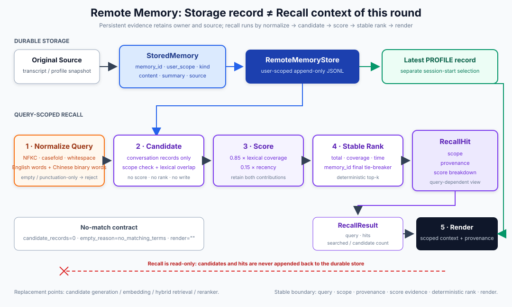
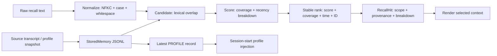
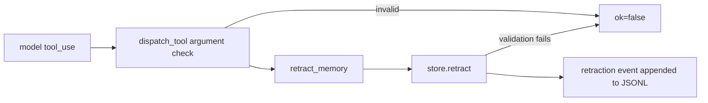

# s12: Remote Memory - Store Records, Recall Context

[中文](README.md) · [English](README.en.md)
> *Remote memory stores durable records; recall returns scoped, scored, source-bearing candidates.*
>
> **Harness layer: remote memory and query-scoped retrieval.**

The retrieval path is explicit: normalize a query, build candidates, score them, apply a stable rank, and render only selected hits.



## What This Lesson Adds

```text
normalize -> candidate -> score -> stable rank -> render
```

## Code Architecture Diagram



## Core Contracts

### StoredMemory: Durable Record

```python
@dataclass(frozen=True)
class StoredMemory:
    memory_id: str
    user_scope: str
    kind: MemoryKind
    content: str
    summary: str
    source: MemorySource
    stored_at: str
```

### MemorySource: Provenance

```python
@dataclass(frozen=True)
class MemorySource:
    source_id: str
    source_type: str
    title: str
    captured_at: str
```

### RecallQuery: This Search Request

```python
@dataclass(frozen=True)
class RecallQuery:
    query_id: str
    text: str
    normalized_text: str
    terms: tuple[str, ...]
    user_scope: str
    limit: int
    issued_at: str
```

### RecallCandidate: Unscored Candidate

```python
@dataclass(frozen=True)
class RecallCandidate:
    query_id: str
    record: StoredMemory
    searchable_terms: tuple[str, ...]
    matched_terms: tuple[str, ...]
    captured_at: datetime
```

### RecallScoreBreakdown: Explainable Score

```python
@dataclass(frozen=True)
class RecallScoreBreakdown:
    matched_terms: tuple[str, ...]
    query_term_count: int
    lexical_coverage: float
    recency: float
    lexical_contribution: float
    recency_contribution: float
    total: float
```

### RecallHit: Query View

```python
@dataclass(frozen=True)
class RecallHit:
    query_id: str
    memory_id: str
    rank: int
    snippet: str
    scope: RecallScope
    provenance: MemorySource
    score_breakdown: RecallScoreBreakdown
```

## Main Code Paths

### Store: Append a Source-Bearing Record

```python
store.append(
    kind=MemoryKind.CONVERSATION,
    memory_id="memory-42",
    content="Selected SQLite WAL for local persistence.",
    summary="Selected SQLite WAL.",
    source=MemorySource(
        source_id="transcript-42",
        source_type="conversation_transcript",
        title="Persistence decision",
        captured_at="2026-08-01T12:00:00Z",
    ),
)
```

### Normalize: Build a Canonical Query

```python
result = RecallEngine(store).recall(
    "  LAYERED   Memory  ",
    limit=5,
)
```

### Candidate: Require Lexical Overlap

### Score and Stable Rank

```text
lexical_contribution = 0.85 * query-term coverage
recency_contribution = 0.15 * recency
total = lexical_contribution + recency_contribution
```

```text
total DESC
-> lexical_coverage DESC
-> source.captured_at DESC
-> memory_id ASC
```

### Result: Structured Tool Output

```json
{
  "query": {
    "query_id": "...",
    "text": "LAYERED Memory",
    "normalized_text": "layered memory",
    "terms": ["layered", "memory"],
    "user_scope": "...",
    "limit": 5
  },
  "hits": [
    {
      "memory_id": "conversation-003",
      "rank": 1,
      "scope": {
        "user_scope": "...",
        "memory_kind": "conversation"
      },
      "provenance": {
        "source_id": "transcript-conversation-003",
        "source_type": "conversation_transcript",
        "title": "layered memory design",
        "captured_at": "..."
      },
      "source": {
        "source_id": "transcript-conversation-003",
        "source_type": "conversation_transcript",
        "title": "layered memory design",
        "captured_at": "..."
      },
      "score": 0.995161,
      "score_breakdown": {
        "matched_terms": ["layered", "memory"],
        "query_term_count": 2,
        "lexical_coverage": 1.0,
        "recency": 0.967742,
        "weights": {
          "lexical": 0.85,
          "recency": 0.15
        },
        "contributions": {
          "lexical": 0.85,
          "recency": 0.145161
        },
        "total": 0.995161
      }
    }
  ],
  "searched_records": 6,
  "candidate_records": 1,
  "empty_reason": null
}
```

### Render: Only Selected Candidates

```xml
<recalled_context query_id="query-1"
                   normalized_query="layered memory"
                   user_scope="...">
  <hit rank="1" memory_id="conversation-003"
       user_scope="..." memory_kind="conversation">
    <score total="0.995161"
           lexical_coverage="1.000000"
           recency="0.967742"
           lexical_contribution="0.850000"
           recency_contribution="0.145161"/>
    <provenance source_id="transcript-conversation-003"
                source_type="conversation_transcript"
                captured_at="..."/>
    <snippet>Separated workspace, user and remote memory boundaries.</snippet>
  </hit>
</recalled_context>
```

## Why Profile Loads Separately

```xml
<remote_profile memory_id="profile-001"
                source_id="profile-snapshot-001"
                captured_at="...">
  ...profile content...
</remote_profile>
```

## Why There Is No Reranker Yet

```text
normalized query
-> source-bearing candidates
-> score breakdown
-> stable rank
-> scoped/provenanced hits
-> rendered context
```

## Boundaries among s09, s10, and s11

The transcript records events, workspace memory records project facts, and user memory records cross-project preferences; remote recall must keep those scopes distinct.

## Failure and Boundary Behavior

No match, invalid scope, provider failure, and malformed records remain explicit outcomes instead of silently becoming prompt context.

## Retraction: Leave the View, Keep the History

### Problem

A wrong conversation memory, or one the user asked to forget, keeps being recalled, and a wrong profile snapshot cannot be undone. How do you "forget" in an append-only log that never rewrites history?

### Solution

`retract(target_id, reason=..., source=...)` appends a `kind=retraction` event whose `retracts` points at the target. The original stays in the `read_all()` audit stream; `recall` and `latest_profile` read the `active_records()` view instead.

### How It Works

- The retraction id is derived from the target: `"retraction-" + sha256(target_id)[:24]`, so repeating a retraction returns the same record; if another record owns that id, `RemoteMemoryDuplicateError` is raised;
- `target_id` and the retraction id pass `_require_record_id`: built-in `str` only, non-empty, no surrounding whitespace, at most 200 chars;
- Public `append()` rejects `RETRACTION`; retracting an unknown id or a retraction is rejected and leaves the file unchanged;
- `active_records()` checks raw JSON types of retractions on disk and raises `RemoteMemoryCorruptionError` on any invalid one.

Known limitation: `append()` accepts only built-in `str` ids (since `PR 44`), and an empty id still becomes a uuid; legacy records with surrounding whitespace or over 200 chars cannot be retracted, and `retract()` says so explicitly.

### Try It

```python
store.retract("conv-1", reason="user asked to forget", source=source)
assert "conv-1" in {r.memory_id for r in store.read_all()}
assert "conv-1" not in {r.memory_id for r in store.active_records()}
```

No API key needed: run the chapter REPL and type `/retract-demo`. It builds a separate store in a temporary directory (seed data with fixed timestamps), walks through "recall → retract → miss → simulated restart still misses → original record still in the audit stream", then shows two invalid retractions being rejected. It never writes the default store, never reads or writes `WORKBUDDY_HOME`, and does not go through the `retract_memory` tool (the tool writes the default store). One real run (ids depend on the seed data):

```text
[before] recall 'explicit user preferences': conversation-003, conversation-005
[before] read_all=7 active=7
[harness] retract conversation-003 -> retraction-beed129bfaf68007d1ae6e27
[after] recall 'explicit user preferences': conversation-005
[after] read_all=8 active=6; conversation-003 still in read_all: True
[restart] recall 'explicit user preferences': conversation-005
[reject] unknown id: rejected
[reject] retraction event: rejected
```

### Architecture Mapping

| View | Method | Includes retracted content |
| --- | --- | --- |
| Audit stream | `read_all()` | yes |
| Active view | `active_records()` | no |

Left to the reader: add `retracted_records` to `RecallResult` and explain whether that count leaks retracted content; implement a physical purge that erases retracted content while keeping retraction events, and design crash recovery for it.

## Agent Tool Entry: retract_memory

### Problem

`retract()` above is library-only. When the user says "forget that" in chat, the model has no tool to call and can only promise.

### Solution

A new tool `retract_memory(memory_id, reason)` is registered in `TOOLS` and `TOOL_HANDLERS`; its handler calls `store.retract()`. The harness fills `source` (`source_type="model_tool"`, same label as s11); the model cannot pass it.

| | s11 `forget_user_preference` | s12 `retract_memory` |
| --- | --- | --- |
| Identifier | preference key | exact `memory_id` |
| Original text | tombstone, value dropped | kept in the `read_all()` audit stream |
| Replay | only "deleted" is visible | original record and retraction event visible |

### How It Works

- `dispatch_tool()` checks arguments against the schema first: missing, extra or wrongly typed arguments return `{"ok": false, "error": ...}` instead of raising `TypeError` at `handler(**input)`;
- validation errors from `retract()` (unknown id, retracting a retraction, empty reason, non-`str` id) also become `ok=false`, and the file is unchanged;
- success returns `{"ok": true, "memory_id", "retracts", "reason"}`; a repeated retraction returns the stored event, so `reason` is the one recorded first;
- "call only when the user explicitly asks this turn" and "do not guess ids" are system-prompt conventions, not harness checks; the harness only enforces what `retract()` validates.

`default_runtime()` rebuilds the system prompt on every call, so a retracted profile disappears from the next turn's prompt.

### Try It

```python
print(dispatch_tool("retract_memory", {"memory_id": "conversation-001", "reason": "user asked to forget"}))
print(dispatch_tool("retract_memory", {"memory_id": "conversation-001"}))  # ok=false
```

### Architecture Mapping



## No-Key Composition Boundary

```text
default_runtime()  -> create the teaching store on the first interactive CLI run or recall_history call
runtime_client()   -> validate MODEL_ID only when the online agent_loop actually requests a model
```

## Offline Verification

```bash
python3 -m pytest -q tests/test_remote_memory.py
python3 scripts/verify.py
```

```bash
python s12_cloud_memory/code.py --demo
```

```bash
MODEL_ID=<model> ANTHROPIC_API_KEY=<key> python s12_cloud_memory/code.py
```

## Interview Summary

The key design lesson is to keep stored records, recall hits, provenance, and prompt admission as separate contracts.

## Next Lesson

- The retrieval path is explicit: normalize a query, build candidates, score them, apply a stable rank, and render only selected hits.

**Reference table**

| Module | Owner | Core object | Question answered |
|---|---|---|---|
| s09 Transcript | Session | Event evidence | What really happened in this turn? |
| s10 Workspace Memory | Workspace | Durable project facts | What remains valid for this project? |
| s11 User Memory | User | Profile and explicit preferences | What is this user's cross-project default? |
| s12 Remote Memory | Remote user/service | Stored records and recall hits | Which long-term history is needed now? |

The original Chinese README remains the primary-language reference. This English companion keeps the same code, diagrams, local paths, and chapter structure so readers can switch languages without losing runnable details.

Local references:

- [Reference](README.md)
- [Reference](README.en.md)
- [Reference](./images/cloud-memory-en.svg)
- [Reference](../examples/layered_memory_walkthrough/)
