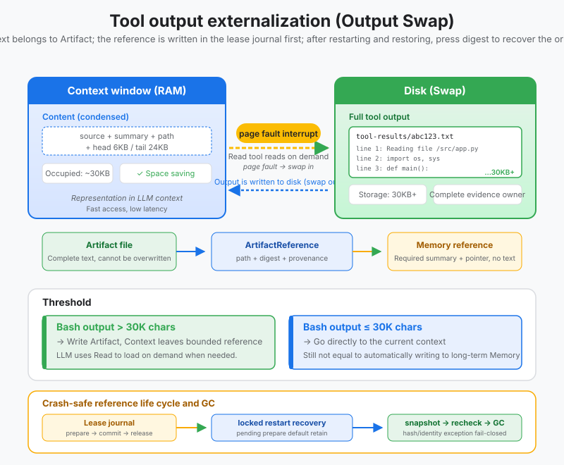
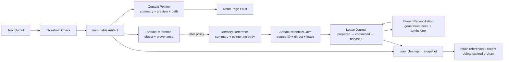

# s13: Tool Output Externalization - Move Large Results to Disk

[中文](README.md) · [English](README.en.md)
> *Context is memory; durable tool output belongs in an artifact with a pointer.*
>
> **Harness layer: context management and artifact lifecycle.**

Large tool results become immutable artifacts. The prompt keeps a bounded preview, digest, provenance, and a readable pointer.



## Code Architecture Diagram



## Prerequisites

- Tool output can be larger than the model's context.
- The context should keep a summary and a pointer, with the original text on disk or in object storage.
- Externalization must be traceable; otherwise the model cannot find the details again.

## WorkBuddy-Style Mechanisms in This Chapter

- Swaps large output into artifact files, keeping only a summary and a path in the prompt.
- Generates a stable source ID, summary, source tool, timestamp, and SHA-256 for each artifact, so it does not become an unauditable anonymous file.
- Memory can receive only an `ArtifactMemoryReference`, which keeps the necessary summary and a retrievable pointer without copying the body of the large result.
- Uses a path-free `ArtifactRetentionClaim` to project Memory references into cleanup leases; the physical path is always decided by S13's trusted session root.
- Appends the lease intent to the journal and fsyncs it before Memory publishes the reference; after a restart, the current claim view is recovered from the journal.
- Reconciles pending leases with a stable transaction ID and a generation-fenced owner observation; an uncertain result keeps protecting the Artifact.
- Splits cleanup into two phases, plan and apply, and re-verifies file identity, mtime, size, and SHA-256 before acting; any change fails closed.
- Simulates on-demand reads of fragments, similar to a page fault.
- Relieves pressure on the compaction in s14.

## Common Mistakes

- Stuffing all tool output back into messages exhausts the window quickly.
- Keeping only the file path without a summary leaves the model unable to tell when to read it.
- Leaving externalized files out of the audit hurts post-mortem review.
- Restarting an in-process counter from `001` overwrites old artifacts, so pointers that were already saved point to the wrong evidence.
- Writing the head/tail preview from the pointer into Memory verbatim is still, in essence, copying a possibly huge or sensitive tool body.
- Deleting the whole `tool-results/` directory when the session ends leaves evidence still referenced by Workspace/User Memory dangling immediately.
- Trusting the `artifact_path` in Memory directly for deletion turns untrusted persisted data into an arbitrary file-deletion entry point.
- Publishing the Memory reference first and recording the in-process claim afterwards produces, in the crash window, Artifacts whose ownership cannot be proven.
- Releasing the lease before deleting the Memory reference leaves, in the opposite crash window, a pointer that is still reachable but has lost its protection.
- Treating a single "not found" query directly as `ABSENT` misses read lag, concurrent updates, or late writes; absence must first be sealed on the owner side.
- Continuing to delete after the scan finds unknown files, symbolic links, digest conflicts, or races violates the fail-closed boundary of evidence cleanup.

## The Problem

How much output can a single `grep -r "TODO" .` command produce?

In a medium-sized project, perhaps a few hundred KB. In a large monorepo, perhaps several MB. If the agent searches from the `/` root - 50 MB is no exaggeration.

The model's context window is 128K tokens, roughly 500 KB of text. **The output of a single command can overflow the context tenfold.**

This is not an edge case. An agent doing real work - reading files, running tests, searching code - pours data into the context with every tool call. `grep` returns 50 MB, `pytest -v` returns 20 MB, `cat large_file.json` returns 100 MB - any one of them can crash the rest of the conversation outright.

You cannot stop the agent from using these tools - it needs to search, read files, and run commands. Nor can you simply truncate the output - the agent may need exactly the error message on line 40000. What you need is: **the full output is not lost, yet the context does not overflow.**

---

## The Solution

```
Tool execution
    │
    ▼
┌──────────────────────┐
│ Output > threshold?          │
└──────────┬───────────┘
      No   │   Yes
      │    │    │
      ▼    │    ▼
  Place directly    │  ┌─────────────────────────┐
  in context  │  │ Write to disk:                │
            │  │   tool-results/         │
            │  │     tool_result_001.txt │
            │  │     (full output)           │
            │  └──────────┬──────────────┘
            │             │
            │             ▼
            │  ┌─────────────────────────┐
            │  │ Put a pointer in context:          │
            │  │   head 6KB              │
            │  │   ... (omitted) ...         │
            │  │   tail 24KB             │
            │  │   [full output at: path]│
            │  └──────────┬──────────────┘
            │             │
            ▼             ▼
       Context grows by ~the original size    Context grows only ~30KB
```

Write the tool's full output to a disk file and keep only a **pointer + preview** in the context. This is the same idea as virtual-memory paging in an operating system - when physical memory (the context window) runs short, data is swapped to disk (`tool-results/*.txt`), and memory keeps only a page-table entry (the pointer).

This chapter goes further and splits one large result into three representations with different lifecycles:

| Representation | Contains | Consumer | Owns the full body? |
|------|----------|----------|------------------|
| Artifact file | Complete tool output | Audit, on-demand reads, full recovery | Yes; the sole body owner |
| Context pointer | Source ID, summary, SHA-256, path, head/tail preview | Current Agent turn | No; bounded representation |
| Memory reference | Required summary, path, digest, and source fields | Later Memory policy | No; it intentionally has no `content` |

These three objects cannot be merged into one string: the prompt needs a short-term preview, Memory needs cross-session retrieval information, and only the artifact is responsible for keeping the original evidence that must not be lost. A Memory reference is also only a candidate input; whether it is kept long term is still decided by the scope and retention policies of s10–s12.

| Concept | Operating system | WorkBuddy |
|------|---------|-----------|
| Memory | RAM | Context window |
| External storage | Disk swap | `tool-results/*.txt` |
| Memory entry | Page-table entry | Pointer plus preview |
| Read-back | Page fault | Read tool |

---

## How It Works

### Threshold Detection

Different tools have different thresholds - Bash output fluctuates widely (perhaps a few bytes, perhaps several MB), so its threshold is higher; other tools have relatively controllable output, so their threshold is lower:

```python
BASH_MAX_OUTPUT_LENGTH = 30000        # chars — Bash Output exceeds this value → externalized
CODEBUDDY_TOOL_RESULT_THRESHOLD_KB = 50  # KB — non-Bash tool output exceeds this value → externalized
```

After Bash output is externalized, the context keeps a truncated version of **head 6KB + tail 24KB ≈ 30KB**. Why head + tail instead of just the head? Because for many commands the key information is at the end - the last few lines of a compile error, the summary of a test run, the command's exit status.

```python
def should_externalize(self, output: str, tool_name: str) -> bool:
    if tool_name == "bash":
        return len(output) > BASH_MAX_OUTPUT_LENGTH
    else:
        return len(output.encode("utf-8")) > CODEBUDDY_TOOL_RESULT_THRESHOLD_KB * 1024
```

### Write to Disk

Output above the threshold is written into the `tool-results/` folder under the session directory, numbered in sequence. File names are reserved through exclusive creation; even if the counter returns to 0 after a process restart, existing files are skipped and old evidence is never overwritten:

```
~/.workbuddy/projects/<workspace>/<session>/
└── tool-results/
    ├── tool_result_001.txt    # full output from the first externalization
    ├── tool_result_002.txt    # full output from the second externalization
    ├── tool_result_003.txt
    └── ...
```

```python
def _next_artifact_path(self) -> Path:
    while True:
        self._counter += 1
        path = self.tool_results_dir / f"tool_result_{self._counter:03d}.txt"
        try:
            path.touch(mode=0o600, exist_ok=False)  # old evidence must not be overwritten
        except FileExistsError:
            continue
        return path
```

### Context Replacement (pointer + preview)

After externalization, the `tool_result` content in the context is replaced with a source header + a truncated preview. The source header tells the Agent and the audit logic "who produced this, where the body is, and whether the content is still consistent":

```python
def make_pointer(self, output: str, artifact: ArtifactReference) -> str:
    head = output[:6 * 1024]       # First 6KB
    tail = output[-24 * 1024:]     # Last 24KB

    return (
        f"[Artifact: {artifact.source.source_id}]\n"
        f"Summary: {artifact.summary}\n"
        f"Source: {artifact.source_tool}; SHA-256: {artifact.content_sha256}\n"
        f"Full output: {artifact.path}\n\n"
        f"{head}\n"
        f"\n... [full output at: {artifact.path}] ...\n"
        f"\n{tail}"
    )
```

What the Agent sees is: source fields + a bounded summary + a 6KB preview of the beginning + an omission notice + a 24KB preview of the end + the disk path. It knows where the full output is and can fetch it back with the Read tool when needed. By default the summary is generated deterministically from the first non-empty line and the output size, so the offline demo does not depend on an API key; a production implementation can replace it with a task-aware summary, but must still limit its length.

### Artifact → Memory Passes Only a Thin Reference

`ArtifactReference.for_memory()` explicitly cuts off the path for copying the body:

```python
memory_reference = result.artifact.for_memory()

# Only summary, artifact_path, content_sha256, source_tool, and source.
# No content and no head/tail preview in the context pointer.
payload = memory_reference.to_dict()
```

`source` uses the same set of core fields as s09 and s12: `source_id`, `source_type`, `title`, `captured_at`. Here `source_id` combines the session, the artifact file name, and a prefix of the content digest; `content_sha256` is used to detect a replaced or corrupted file. Nothing is written to Memory directly here, because whether an artifact is worth keeping across sessions still needs a later policy decision.

### Reference-Aware Lifecycle and GC

Artifacts cannot accumulate forever, nor can they be deleted wholesale along with the session. S13 models "is this evidence still needed" as a bounded lease:

```text
ArtifactMemoryReference
    └─ ArtifactRetentionClaim
         ├─ source_id              # path-free owner identity
         ├─ content_sha256         # full digest
         ├─ reference_count        # active reference count aggregated by the Memory adapter
         └─ retain_until?          # optional lease expiration time
```

`ArtifactRetentionClaim` intentionally has no path. The cleaner only parses `artifact:<session>:<filename>:<digest>` and requires the session to match the current `ToolResultExternalizer`; the file's final location can only be derived from the trusted `session_dir/tool-results`. Cross-session claims, path components, and mismatched digests are rejected before any deletion.

#### Crash-recoverable lease journal

An in-process claim cannot cross a crash boundary on its own. `ArtifactRetentionJournal` writes an append-only `retention-leases.jsonl` at the session root; each record contains an increasing sequence, the hash of the previous record, and its own SHA-256. The reader ignores only an incomplete last record that has no newline; a complete bad line, a sequence gap, a cross-session record, a rewritten intent, or a broken hash chain all make recovery fail, and GC never treats a corrupted log as "no references".

The reference-publication protocol runs in this order:

```text
1. PREPARED  ── append + fsync ──▶ the lease intent is persisted
2. Memory adapter publishes the reference
3. COMMITTED ── append + fsync ──▶ the reference is confirmed visible
```

An exception in step 2 does not mean "the reference was not written": Memory may have persisted the reference while the success acknowledgment never reached the Harness because of a timeout or a dropped connection. `publish_reference()` appends `ABORTED` only when the trusted adapter raises `ArtifactPublicationRejected`; that type must guarantee that **the reference was not written and no in-flight write can still commit**. This guarantee must not be inferred directly from an exception message, an HTTP status code, or model output.

Other exceptions (including `TimeoutError`, `ConnectionError`, `OSError`, and plain `RuntimeError`) propagate unchanged, and the lease stays `PREPARED`. A process exiting after step 1 is recovered the same way: whether the Memory write has not happened yet, is in progress, or has already succeeded but step 3 has not run, a fresh journal recovers `PREPARED` as a protective claim with no expiration time and puts the transaction ID into `pending_transaction_ids` to wait for reconciliation by the trusted adapter. Even if the original `retain_until` and the orphan TTL have expired, GC still keeps the evidence; this is a pending-reconciliation state, not a permanently completed one.

The deletion direction uses the opposite safe order: the Memory adapter deletes the reference first, and only after that succeeds is `RELEASED` appended. `remove_reference()` encapsulates this order; if deletion fails or the process exits first, the committed lease keeps protecting the Artifact.

```python
journal = ArtifactRetentionJournal(session_dir)
claim = ArtifactRetentionClaim.from_memory_reference(memory_reference)

transaction, stored_record = journal.publish_reference(
    claim,
    lambda: memory_adapter.append(memory_reference),
    transaction_id="workspace-artifact-reference-1",
)

# Release only after Memory deletion succeeds; keep the lease committed on errors.
journal.remove_reference(
    transaction.transaction_id,
    lambda: memory_adapter.remove(memory_reference.source.source_id),
)
```

A successful return from the publisher must mean the reference has been persisted. An explicit rejection can come from adapter validation that never started a write, for example:

```python
def publish_validated_reference():
    if not memory_adapter.accepts(memory_reference):
        # Local validation only; no write has started.
        raise ArtifactPublicationRejected("reference rejected before write")
    # Do not convert an ordinary exception here into an explicit rejection: the write result may be uncertain.
    return memory_adapter.append(memory_reference)
```

`publish_reference()` does not automatically replay an existing transaction ID. On seeing an existing `PREPARED`, the Harness must first reconcile with the Memory owner: `commit()` only after confirming the reference is persisted; `abort()` only after confirming the reference was not published and ruling out in-flight writes. A single "not found" query is not enough on its own to rule out a delayed commit or a lagging read view. On seeing an existing `COMMITTED`, the publisher must not be called again either. This way a retry never turns "unsure whether it already succeeded" into a duplicate Memory write.

#### Generation-fenced owner reconciliation

`ArtifactReferenceOwner` is the trusted boundary that the Memory adapter must implement. The context manager returned by `inspect_fenced(transaction)` excludes publication changes for the same transaction ID for the whole decision, and provides an `ArtifactReferenceObservation`:

| Owner observation | Harness behavior | Lease result |
|---|---|---|
| `PUBLISHED`, source ID and full digest match | Append `COMMITTED` inside the fence | Protect the reference by its lease |
| `PUBLISHED`, identity mismatch | Record `pending_conflict` | Keep `PREPARED` and protect indefinitely |
| `UNKNOWN` | Record `pending_unknown` | Keep `PREPARED` and retry later |
| Unsealed `ABSENT` | Owner writes a tombstone with CAS and advances generation | Append `ABORTED` after sealing |
| Generation changed before sealing | Record `pending_stale` | Keep `PREPARED` and observe again |
| Sealed `ABSENT` | Do not seal again; complete the journal transition | Append `ABORTED` |

The missing path intentionally uses the order `owner tombstone → journal ABORTED`. The tombstone must permanently reject late writes and future replays for this stable transaction ID. If the process exits after the tombstone fsync but before the journal append, the Artifact is still protected by `PREPARED`; after the restart, the owner returns a sealed absence, and `ABORTED` is then completed safely. Doing it the other way round, aborting first and sealing afterwards, reopens the window where "GC has deleted the evidence, and a late Memory reference then becomes visible".

```python
# The adapter maps the database row version, ETag, or object generation to a fence.
reports = journal.reconcile_pending(memory_owner_adapter)
for report in reports:
    audit_sink.append(report.to_dict())
```

`reconcile_pending()` handles only the pending snapshot seen when the call starts; prepares added concurrently are left for the next round. A single `reconcile_reference()` and terminal reports are both idempotent: concurrent reconcilers append at most one terminal event, and the later ones get `already_committed`, `already_aborted`, or `already_released`. Reports contain only the transaction ID, status, reason, and generation; they carry no physical paths, Memory bodies, or credentials.

S13 cannot provide a default implementation here that "fits every Memory": local JSONL, SQLite, remote databases, and object storage have different linearization points. A concrete adapter must implement the exclusive fence, the conditional tombstone, and the stable publication ID inside the real Memory owner; querying the generation twice on the client side cannot replace a server-side CAS or transaction.

Cleanup is split into two phases:

1. `plan_cleanup()` scans read-only, computes SHA-256 in a streaming way, and freezes a snapshot of size, mtime, device, and inode; the default policy is dry-run.
2. `apply_cleanup()` handles only the `planned_delete` entries in the plan and is forced to receive the current claim view at execution time; a newly added active claim keeps the file. Before deleting, it also re-checks ownership, file type, snapshot, and digest; any change fails closed.

| Status | Meaning | Delete? |
|---|---|---|
| `retained_referenced` | Active claim and full digest match | No |
| `retained_recent` | Orphan TTL has not elapsed | No |
| `retained_limit` | Maximum deletion count reached | No |
| `retained_unknown` / `denied` | Outside the S13 file, directory, or symlink boundary | No |
| `retained_corrupt` | Claim conflicts with file digest or snapshot | No |
| `missing_referenced` | Active claim points to a missing artifact | No file to delete; report the dangling reference |
| `planned_delete` | TTL elapsed and no active claim exists | Dry-run only reports |
| `deleted` | Revalidation succeeded during apply | Yes |
| `already_missing` / `race_detected` | Repeated run or file changed after planning | No |

```python
claim = ArtifactRetentionClaim.from_memory_reference(
    memory_reference,
    reference_count=2,
    retain_until="2026-09-01T00:00:00+00:00",
)
policy = ArtifactCleanupPolicy(
    orphan_ttl_seconds=24 * 60 * 60,
    max_deletions=100,
    dry_run=False,
)
journal = ArtifactRetentionJournal(session_dir)
plan = externalizer.plan_cleanup_from_journal(journal, policy=policy)
report = externalizer.apply_cleanup_from_journal(plan, journal)
```

`reference_count` is aggregated by the trusted Memory adapter rather than declared directly by the model; multiple committed/pending leases for the same Artifact are aggregated by full digest. After a claim is absent or its lease expires, the file must still exceed the orphan TTL before it becomes eligible for deletion. `prepare()` and journal-aware cleanup use the same exclusive lock: prepare re-verifies the typed source, the regular-file boundary, and the full digest inside the lock; apply re-folds the claims inside the lock and holds the lock until file revalidation and deletion finish. If the lease takes the lock first, GC keeps the file; if GC deletes first, prepare refuses to publish a dangling reference. Once a session has a durable journal, the old raw-claims cleanup entry point refuses to run, so callers cannot accidentally bypass the real owner. Cleanup plans/reports and recovery reports accept no physical paths. Production object storage should map the same contract to a generation fence, conditional deletion, or transactions, rather than assume a local advisory lock works across hosts.

### On-Demand Read (Read = Page Fault)

When the agent finds that key information was omitted from the preview, it calls the Read tool to read the full file on disk - this is the **page fault**:

```
Agent context                           Disk
┌─────────────────────┐               ┌──────────────────────┐
│ tool_result:         │               │ tool_result_001.txt  │
│   head 6KB ...       │               │ (50MB full output)       │
│   [full at: path]    │── Read ──▶    │                      │
│   ... tail 24KB      │               │                      │
│                      │◀──content──   │                      │
│ Read result:         │               │                      │
│   line 40000: ERROR  │               │                      │
└─────────────────────┘               └──────────────────────┘
       ~30KB                              does not enter context
```

```python
def read_artifact(self, artifact: ArtifactReference, offset: int = 0, limit: int = 2000) -> str:
    """Read owned evidence on demand and verify its digest first."""
    owned_path = self._owned_path(artifact.path)
    encoded = owned_path.read_bytes()
    if hashlib.sha256(encoded).hexdigest() != artifact.content_sha256:
        raise ArtifactIntegrityError("artifact digest mismatch")
    content = encoded.decode("utf-8")
    lines = content.split("\n")
    selected = lines[offset:offset + limit]
    return "\n".join(selected)
```

---

## OS Analogy: Virtual Memory Paging

This comparison maps large-output artifacts, context pointers, and retention to the corresponding WorkBuddy-style harness boundary.

| OS concept | WorkBuddy equivalent | Explanation |
|---------|---------------------|------|
| Physical memory (RAM) | Context window | Limited, fast, and expensive |
| Disk swap | `tool-results/*.txt` | Large, slower, and cheap |
| Page-table entry | Pointer plus preview | Small reference to the actual data |
| Page fault | Read tool reads a disk file | Bring data back on demand |
| Demand paging | Externalize output and Read on demand | Do not load data until needed |
| Process isolation | Independent SubAgent context | Prevent child context pollution |
| Asynchronous I/O | Background task mechanism | Long work does not block context |
| Memory reclamation / GC | Compact and auto-compact | Compact when context fills |
| Filesystem | Three-layer memory system | Remote -> user -> workspace |
| Replay limit | Replay at most 1000 events | Prevent history from exhausting memory |

## Three-Layer Defense Framework

```
┌─────────────────────────────────────────────────────────┐
│ Layer 1: entry control (this chapter, s17)                              │
│   ├─ tool output externalization (large output → disk, only a pointer remains in context)        │
│   ├─ deferred tool loading (load schemas on demand, s04)                  │
│   ├─ background-task isolation (move long tasks to the background, do not consume context)              │
│   └─ SubAgent context isolation (child Agent gets an independent context)            │
│                                                         │
│   Strategy: keep large content out of context from the start (preventive)            │
├─────────────────────────────────────────────────────────┤
│ Layer 2: active compaction (s18)                                   │
│   ├─ pre-message compact (10% threshold, compact before a message)          │
│   └─ auto compact (70-92% threshold, automatic compaction)                │
│                                                         │
│   Strategy: compact when context becomes too large (remedial)                        │
├─────────────────────────────────────────────────────────┤
│ Layer 3: persistence extensions (s14-s16)                             │
│   ├─ cloud memory (user profile, server-side retrieval)                      │
│   ├─ user-level memory (MEMORY.md, manually maintained preferences)                     │
│   └─ workspace memory (daily log, append-only)                        │
│                                                         │
│   Strategy: move unneeded context to external storage and retrieve it on demand               │
└─────────────────────────────────────────────────────────┘
```

## Why This Comes Before Smart Memory

```
Without output externalization:
  Turn 1: grep → 50MB → context overflows → 💥 API error → task terminates

With output externalization:
  Turn 1: grep → 50MB → externalized → Context +30KB → continue running
  Turn 2: pytest → 20MB → externalized → Context +30KB → continue running
  Turn 3: cat → 100MB → externalized → Context +30KB → continue running
  ...
  Turn 50: Context is still not full → task completes ✅
```

## WorkBuddy Architecture Comparison

This comparison maps large-output artifacts, context pointers, and retention to the corresponding WorkBuddy-style harness boundary.

### Environment Variables and Thresholds

```bash
# Bash output exceeds this length → write to disk, keep head+tail in context
BASH_MAX_OUTPUT_LENGTH=30000

# non-Bash tool result exceeds this size → write to disk, keep a placeholder in context
CODEBUDDY_TOOL_RESULT_THRESHOLD_KB=50
```

### On-Disk File Layout

```
~/.workbuddy/projects/<workspace-hash>/<session-id>/
└── tool-results/
    ├── tool_result_001.txt
    ├── tool_result_002.txt
    └── ...
```

### Head + Tail Strategy for Bash Output

```javascript
// Bash output handling in the agent bridge (simplified)
if (output.length > BASH_MAX_OUTPUT_LENGTH) {
    const head = output.slice(0, 6 * 1024);
    const tail = output.slice(-24 * 1024);
    const filePath = writeToolResultToDisk(output, sessionDir);

    // Replace context with pointer
    toolResult.content = (
        head + "\n" +
        `[... omitted, full output at: ${filePath} ...]\n" +
        tail
    );
}
```

### Placeholder Strategy for Non-Bash Tools

```javascript
// non-Bash tool result handling (simplified)
if (resultSize > CODEBUDDY_TOOL_RESULT_THRESHOLD_KB * 1024) {
    const filePath = writeToolResultToDisk(result, sessionDir);
    toolResult.content = (
        `[Output externalized to: ${filePath}]\n` +
        `Preview: ${result.slice(0, 2048)}...\n` +
        `Use Read tool to access full content.`
    );
}
```

### Working with Background Tasks

Use these exercises to change one part of large-output artifacts, context pointers, and retention at a time and explain the resulting contract.

## Code Walkthrough

```
[externalize] tool_result_001.txt written, 1.3MB → 2KB in context (saved 99.8%)
[page-fault]  agent requested full output, reading tool_result_001.txt from disk
```

## Run

```bash
python s13_output_externalization/code.py
```

## Exercises

Use these exercises to change one part of large-output artifacts, context pointers, and retention at a time and explain the resulting contract.

## Next Lesson

- Large tool results become immutable artifacts. The prompt keeps a bounded preview, digest, provenance, and a readable pointer.

The original Chinese README remains the primary-language reference. This English companion keeps the same code, diagrams, local paths, and chapter structure so readers can switch languages without losing runnable details.

Local references:

- [Reference](README.md)
- [Reference](README.en.md)
- [Reference](./images/output-externalization-en.svg)
