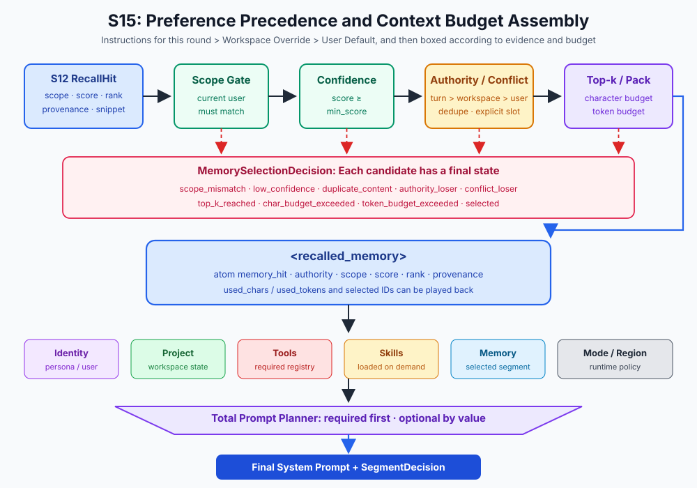
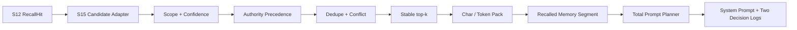

# s15: Prompt Assembly - Select First, Assemble at Runtime

[中文](README.md) · [English](README.en.md)
> *A prompt is assembled from governed blocks; it is not one unstructured string.*
>
> **Harness layer: context selection, budget, authority, and system prompt assembly.**

This lesson gives memory selection an explicit contract for scope, confidence, authority, conflicts, deduplication, and token budget.



## What This Lesson Adds

S12 has already rewritten remote records into an explainable recall chain:

```text
query → candidate → score → stable rank → RecallResult
```

But "recalled" does not mean "should enter the Prompt". Recall results may still contain:

- data from other user scopes;
- low-confidence records with only weak lexical overlap;
- records with duplicate content from different sources;
- old/new conflicts within the same fact slot;
- records ranked low, beyond top-k;
- single records so long that they crowd out other context.

Therefore S15 owns the second half of the chain:

```text
RecallResult
  → scope gate
  → confidence gate
  → authority precedence
  → exact dedupe
  → explicit conflict resolution
  → stable top-k / budget packing
  → <recalled_memory>
  → total prompt segment planner
```

Every candidate on this path ends with a `selected` or `rejected` decision and a machine-readable reason code.

## Code Architecture Diagram



## s12 and s15 Responsibilities

| Chapter | Owns | Does not own |
|---|---|---|
| S12 Remote Memory | Query normalization, candidate generation, score breakdown, stable ranking, scope, and provenance | The final decision about which hits enter the prompt |
| S15 Prompt Assembly | Scope/confidence gates, authority, deduplication, conflicts, top-k, budgets, and prompt assembly | Retrieval scoring or long-term memory writes |

`memory_candidates_from_recall()` only does structural adaptation: it copies S12's `scope`, `score`, `rank`, and `provenance` without silently recomputing them. S12 records are marked `user_default` by default; only a trusted Harness caller can explicitly mark a workspace override or a current-turn instruction through `authority_by_memory_id`. This way retrieval and selection can be tested and evolved independently.

## Memory Selection Contract

### `MemoryContextCandidate`

A candidate contains:

- `memory_id`: stable identity;
- `text`: compact text ready to enter the context;
- `user_scope`: ownership boundary;
- `score`: the recall score produced by S12;
- `source_rank`: S12's stable rank;
- `provenance`: source ID, type, title, and capture time;
- `conflict_key`: optional explicit fact slot;
- `authority`: `current_turn`, `workspace_override`, or `user_default`.

`conflict_key` is not guessed by S15 from natural language. For example, an "automation language preference" can be labeled `preference:automation-language` by a structured memory producer. Having Prompt Assembly call another model to judge contradictions would hide an unobservable second round of reasoning in the critical path.

### `MemorySelectionPolicy`

```python
policy = MemorySelectionPolicy(
    min_score=0.35,
    top_k=5,
    max_chars=3_000,
    max_tokens=800,
)
```

Characters and tokens are two independent constraints. The character budget suits fully offline, deterministic teaching regression; the token budget can inject the target model's tokenizer:

```python
plan = select_memory_context(
    candidates,
    user_scope=current_scope,
    policy=policy,
    token_counter=target_model_tokenizer,
)
```

The default `estimate_context_tokens()` is only a transparent offline estimate: Latin word groups, single CJK characters, and punctuation each count as one teaching unit. It does not pretend to be any vendor's tokenizer.

### `MemoryContextPlan`

The Plan returns at the same time:

- `context`: the in-budget `<recalled_memory>`;
- `used_chars` / `used_tokens`: the real packing cost, including the XML wrapper and provenance attributes;
- `selected_memory_ids` / `rejected_memory_ids`;
- `decisions`: each candidate's authority level, status, reason, linked winner, and explanation text.

## Three Preference Authority Levels, Not Three Score Weights

The same fact slot may have three kinds of valid input at once:

| Authority | Meaning | Example |
|---|---|---|
| `current_turn` | Explicit requirement for the current task | "Use Go for this implementation" |
| `workspace_override` | Local convention of the current project | "This repository uses TypeScript for automation" |
| `user_default` | Cross-project personal default | "I usually prefer Python" |

The arbitration rule is fixed as:

```text
current_turn > workspace_override > user_default
```

This is not multiplying score by another weight. A lower-level candidate cannot override a higher-level one even if it has a higher score, an earlier rank, or a newer source; retrieval evidence is compared only within the same authority:

```text
authority desc → score desc → source_rank asc → captured_at desc → memory_id asc
```

The authority field is supplied by the Harness boundary; the model cannot invent a higher level such as `system_override`. Unknown values fail closed. The default is `user_default`, so the existing S12 adapter and hand-written candidates remain compatible.

### Authority Is Not Harness Required

`current_turn` is the highest level among preference candidates, but it is still not a system safety rule. Base instructions, tool boundaries, and Working mode continue to be carried by required `PromptSegment`s:

- authority only decides, among candidates, who wins and who uses the Memory budget first;
- required segments reserve the total Prompt budget first, and no preference can override or squeeze them out;
- when the required segments themselves do not fit, `PromptBudgetError` is raised; safety rules are never downgraded to optional preferences.

The current-turn user message is still passed to the model through conversation messages; the `current_turn` candidate is its structured arbitration projection and audit evidence, and must not replace the original user message.

## Why Selection Order Matters

### 1. Scope Gate

A candidate's `user_scope` must match the current query scope. Even if a cross-user candidate has the highest score, it is rejected first with `scope_mismatch`; ranking must not override the safety boundary.

### 2. Confidence Gate

Records below `min_score` are rejected with `low_confidence`. Low confidence does not mean "ranked last but maybe usable"; it means abstain by default, so noise is not put back into the Prompt when the budget is loose.

### 3. Authority Precedence

Candidates that pass the gates are first sorted by the three authority levels. This order controls the dedupe winner, the conflict winner, and the later top-k/budget packing at the same time, preventing a lower-level high-score candidate from taking space and making the current-turn requirement disappear.

Authority cannot bypass the first two gates: a `current_turn` projection that crosses scope or falls below `min_score` is still rejected.

### 4. Exact Deduplication

Both the body text and the explicit `conflict_key` go through NFKC, case folding, and whitespace normalization; deterministic exact dedupe happens only when both the fact slot and the body text are identical. The candidate with the stronger ordering is kept; the others record `duplicate_content`, the winner ID, and the normalized slot. Candidates without a `conflict_key` are deduplicated only against candidates that also have no slot, and never replace a slotted record.

For example, current-turn instruction A is `Use Python` in the analysis-language slot, workspace preference B is `Use Python` in the automation-language slot, and user default C is `Use Bash` in the automation-language slot. A and B have the same body text but describe different slots, so both must enter the conflict stage; B then beats C by authority. If B were deleted by body text alone, C would be wrongly selected. Identical body text does not make fact-slot information discardable.

Identical body text in different slots may each take its own share of the context budget, because they carry different fact constraints and sources. If B is ultimately not selected because the budget is short, C, already beaten by B, does not backfill either; dedupe, conflict resolution, and budget packing still run in their original order.

This deliberately does not claim semantic deduplication. Production can add an embedding cluster upstream, but it must keep emitting traceable winner/loser relationships.

### 5. Explicit Conflict Resolution

Different contents with the same `conflict_key` compete for the same fact slot. Across authority levels, the lower-level candidate is rejected with `authority_loser`, recording the winner ID and both levels; same-level conflicts continue to use `conflict_loser`.

Same-level candidates are stably sorted by the following key:

```text
score desc → source_rank asc → captured_at desc → memory_id asc
```

The first becomes the winner. A conflict loser does not backfill because the winner is too long or the current budget changes, because it expresses a fact that has already been ruled out, not merely expensive context.

### 6. Top-k and Budget

Surviving candidates are tried one by one in the authority-first stable order:

- when the selection is already full: `top_k_reached`;
- when adding it exceeds the character budget: `char_budget_exceeded`;
- when adding it exceeds the token budget: `token_budget_exceeded`;
- when both budgets are satisfied: `selected`.

Each `<memory_hit>` is an atomic block and is never truncated in the middle. A high-score record that is too long is rejected, but packing does not stop; smaller later candidates can still fill the remaining budget until top-k is full.

## Two Budget Layers, Not One Vague Length Limit

S15 makes two different decisions:

```text
Memory candidates
  └─ MemorySelectionPolicy
       └─ <recalled_memory> segment
            └─ plan_prompt(total prompt budget)
                 └─ final system prompt
```

The first layer selects facts inside memory and can explain why each hit was rejected; the second layer compares the value of persona, memory, project, skills, and other segments across the whole system prompt. If the total Prompt budget is tighter, the entire memory segment may still be dropped atomically, with the reason recorded by `SegmentDecision`. Even if a `current_turn` projection exists in memory, it cannot upgrade the optional Memory segment into a required system rule.

These two decision logs cannot be merged: one answers "why was this memory not selected", the other answers "why was this Prompt segment not included in the end".

## System Prompt Sections

| # | Segment | Source | Condition | Total-budget policy |
|---|---|---|---|---|
| 1 | Base instructions | Harness rules | Always | required |
| 2 | Identity | SOUL / IDENTITY / USER | File exists or teaching default | Optional, high value |
| 3 | Recalled memory | S12 -> S15 selection plan | The query selected hits | Optional, medium value |
| 4 | Project context | Workspace structure | Always built | Optional, high value |
| 5 | Tool descriptions | Tool registry | Tools exist | required |
| 6 | Expert instructions | Active expert | When active | Optional, high value |
| 7 | Skill instructions | Loaded `SKILL.md` | When loaded | Optional, high value |
| 8 | Connector status | MCP connectors | When connectors exist | Optional, lower value |
| 9 | Regional conventions | Current region | Region-specific | Optional, low value |
| 10 | Working mode | craft / plan / ask | Always | required |

### Display Order and Budget Values

`priority` decides where a segment finally appears in the Prompt, and `budget_priority` decides who gets space first when the budget is tight. The working mode can be placed at the end of the Prompt yet still be a non-removable required segment.

The total Prompt planning flow is:

```text
Build fragments and record provenance
  → reserve required fragments first
  → fail closed when required fragments exceed the budget
  → try to add optional fragments by budget_priority
  → render selected fragments by priority
  → PromptPlan + SegmentDecision
```

If required segments themselves exceed the budget, `PromptBudgetError` blocks the provider call instead of silently deleting safety rules.

## Runtime Assembly

The system prompt is cached, but the following state changes trigger reassembly:

| Event | Affected segment |
|---|---|
| New S12 recall candidates | Memory selection and memory segment |
| Query ends or user scope changes | Clear the memory segment to prevent leakage |
| Skill loads | Skill instructions |
| Expert switches | Expert instructions |
| Working mode changes | Working mode |
| Connector starts/stops | Connector status |
| Identity file changes | Identity |

`set_recalled_memory()` stores candidates, not the last rendered string. Each reassembly replans under the current scope, policy, and tokenizer. `clear_recalled_memory()` explicitly ends query-scoped state.

## Demo Without an API Key

```bash
python s15_prompt_assembly/code.py
```

After entering interactive mode, type:

```text
memory
```

The teaching fixture produces at once: User Default, Workspace Override, a current-turn instruction, a same-slot cross-level conflict, a low-confidence candidate, and a cross-user candidate. The terminal shows each record's authority, rank, score, selected/rejected, reason code, and explanation, and shows both budget layers: memory and the total Prompt.

Then type:

```text
memory clear
```

to see the Memory segment become inactive after the query ends.

You can also tighten the total Prompt character budget:

```bash
PROMPT_BUDGET_CHARS=2000 python s15_prompt_assembly/code.py
```

`PromptSegment`, `MemoryContextCandidate`, `select_memory_context()`, and `plan_prompt()` are all pure standard-library offline contracts. Only when actually entering `agent_loop()` does `runtime_client()` check `MODEL_ID`, the provider SDK, and API configuration.

## Common Mistakes

- **Concatenating RecallHit directly into the Prompt**: skips scope, conflict, and budget decisions.
- **Keeping only the total score**: cannot explain low confidence or the conflict winner.
- **Deciding conflicts by input order**: a change in JSONL order flips facts.
- **Letting high score override high authority**: retrieval relevance cannot change the permission boundary of user instructions.
- **Letting the model declare authority itself**: the model may propose content but cannot grant itself higher authority.
- **Treating `current_turn` as required**: user preference levels cannot override Harness safety rules.
- **Slicing long memories by string**: may cut through provenance, XML, and fact semantics.
- **Writing a miss as an empty `<memory>`**: wastes tokens and makes the model think memory evidence exists.
- **Calling a character estimate real tokens**: tokenizers differ across models and should be injected explicitly.
- **Deleting safety rules when the total budget is short**: required must fail closed.
- **Not clearing memory state after a query ends**: may leak the previous candidates to the next user or the next question.

## Interview Questions

1. What problems do retrieval, selection, packing, and prompt assembly each solve?
2. Why must scope and confidence come before deduplication, conflicts, and budget?
3. Why does a conflict need an explicit slot instead of being replaced by string deduplication?
4. After a high-scoring long candidate exceeds the budget, why may a small candidate backfill while a conflict loser may not?
5. Why do we need two audits, a memory decision log and a segment decision log?
6. How can a real tokenizer be integrated without breaking offline regression and the upper-level API?
7. How can exact deduplication be upgraded to semantic deduplication while keeping deterministic replay?
8. Why must authority come before score, and why must it still come after the scope and confidence gates?
9. What are the permission boundaries of `current_turn` and a required PromptSegment, respectively?

## Exercises

1. Inject the target model's tokenizer, compare how selection differs from the default estimator, and verify that the decision log of each run is reproducible.
2. Add a structured `fact_type + subject` upstream to produce a more reliable conflict key.
3. Add a "must keep" Memory type, consider how it differs from the Harness required safety rules, and whether it should fail closed when the budget is insufficient.
4. Aggregate decision reasons into offline eval metrics, such as scope rejection rate, low-confidence abstention rate, and budget utilization.
5. Add a signature or event binding to the authority source, and show that the hierarchy is produced by the trusted Harness rather than forged by the model.

## Next Lesson

S15 can already select retrieval results and pack them into the Prompt. Next, S16 handles on-demand loaded Skills, so extended knowledge does not have to stay resident in the context from the start of the session.

The original Chinese README remains the primary-language reference. This English companion keeps the same code, diagrams, local paths, and chapter structure so readers can switch languages without losing runnable details.

Local references:

- [Reference](README.md)
- [Reference](README.en.md)
- [Reference](./images/prompt-assembly-en.svg)
