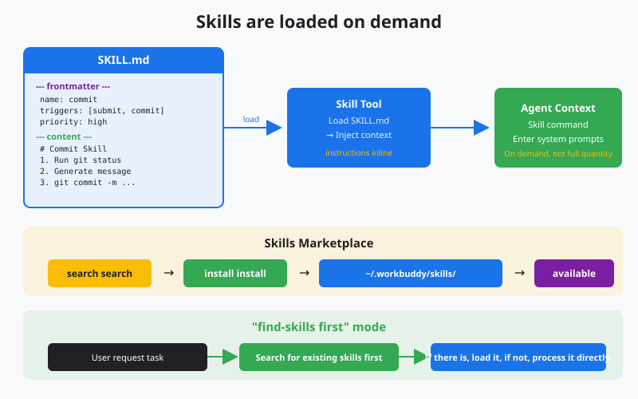
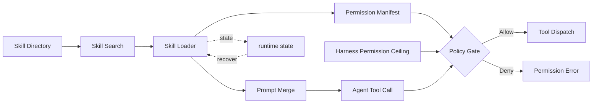

# s16: Skills System - List First, Expand on Demand

[中文](README.md) · [English](README.en.md)
> *Skills are indexed as short instructions and loaded only when a task needs them.*
>
> **Harness layer: extensibility, lazy loading, and skill permission boundaries.**

A skill combines frontmatter, instructions, optional scripts, and explicit permissions. Indexing stays small; full content is loaded on demand.



## Code Architecture Diagram



## Prerequisites

- A skill is an operating guide loaded on demand, not a tool itself.
- A good skill usually contains SKILL.md, scripts, references, and assets.
- The skill catalog and the skill body should be loaded separately.

## WorkBuddy-Style Mechanisms in This Chapter

- Absorb the Skills + Plugins + Hooks extension approach from public architecture research.
- Use progressive disclosure to control token cost.
- Let skills carry scripts, reference material, and resource files.

## Common Mistakes

- Injecting the full text of every skill into the prompt wastes context.
- If a skill is written as generic advice, the model does not know when to trigger it.
- If scripts and reference material have no boundaries, the skill becomes hard to reuse.
- Mistaking Connector trust or a Skill declaration for authorization; neither can break through the Harness base permissions.

## The Problem

The agent has basic tools (bash, read, write), a memory system, and an identity. But different tasks need different **operating guides**: committing code has commit conventions, code review has a review process, and deployment has a deployment checklist. If all of these are stuffed into the system prompt, the prompt bloats to an unacceptable size.

You need a mechanism: **normally list only the skill catalog (name + when to use it), and load the full content only when it is needed.** Just like human knowledge: you know which books are in the library (the catalog), but you open a specific book only when you need it.

WorkBuddy's Skills system solves this problem. Each skill is a directory containing a `SKILL.md` file. The head of `SKILL.md` has YAML frontmatter: title, summary, trigger conditions, and permission declarations. At startup the system scans only the frontmatter to build the index, without loading the full text. Only when the user's input matches a trigger condition is the corresponding skill's full content loaded into context; its tool calls must also pass both the Skill manifest and the Harness base permissions.

## The Solution

Two-level storage + on-demand loading (**production shape** below; this teaching REPL currently does not read these directories — see the teaching-boundary note under How It Works):

```
Skill storage:

  user-level: ~/.workbuddy/skills/          (personal, shared across projects)
    ├── git-commit/
    │   └── SKILL.md
    ├── code-review/
    │   └── SKILL.md
    └── deploy-check/
        └── SKILL.md

  project-level: {workspace}/.workbuddy/skills/ (project-specific, shared with the team)
    ├── api-design/
    │   └── SKILL.md
    └── test-conventions/
        └── SKILL.md
```

Loading flow:

```
At startup:
  ┌─────────────────────────────────────────────────┐
  │ 1. scan all SKILL.md files in both directories                    │
  │ 2. parse only frontmatter (title, summary, read_when)│
  │ 3. build the skill index (do not load full content)                   │
  │ 4. inject the index into the system prompt (use only a few hundred tokens)             │
  └─────────────────────────────────────────────────┘

When the user enters a request:
  ┌─────────────────────────────────────────────────┐
  │ 1. User input: "Help me commit code"                        │
  │ 2. match trigger words: "commit" → git-commit Skill            │
  │ 3. load the complete git-commit/SKILL.md              │
  │ 4. inject into the system prompt (reassemble, s15)                    │
   │ 5. agent receives the complete guide to committing code                   │
  └─────────────────────────────────────────────────┘
```

| Stage | What happens | Loaded amount |
|------|-------|-------|
| Index | Scan frontmatter and build the catalog | About 50 tokens per skill |
| Match | Compare user input with trigger phrases | 0 tokens |
| Load | Read the complete matching `SKILL.md` | About 500-5000 tokens per skill |

## How It Works

> **Teaching boundary (current):** A production Skills system scans user-level `~/.workbuddy/skills` and project-level `{workspace}/.workbuddy/skills` for `*/SKILL.md`. In **this teaching chapter**, `build_skill_index()` **currently** builds the index only from the in-memory `SEED_SKILLS` dict; `create_skill` / `approve` only mutate the in-memory skill index and `pending_skills`, which disappear when the process exits. Directory diagrams and `scanSkillDir` sketches below are the **production shape** — this teaching REPL **currently** does not read those directories (that does not permanently rule out a future on-disk loader).

### SKILL.md Structure

Each skill's `SKILL.md` contains YAML frontmatter and a Markdown body:

```markdown
---
title: git-commit
summary: Standard Git commit workflow
read_when:
  - commit code
  - commit
  - git push
  - preserve changes
agent_created: false
permissions:
  tools: [bash]
  network: false
  paths:
    read: ["**"]
    write: []
---

# Git Commit Skill

## Steps
1. Run `git status` to inspect changes
2. Run `git diff` to inspect changes
3. Stage relevant files `git add`
4. generate a conventional commit message:
   - format: `type(scope): description`
   - type: feat/fix/docs/refactor/test/chore
5. commit: `git commit -m`

## Notes
- Do not commit sensitive information
- Use Chinese for the commit message
```

`permissions` is a requested capability, not a granted capability. The effective permissions are always:

```text
Harness Base permissions ∩ currently approved Skill manifest
```

Fields use a strict allowlist: unknown fields, absolute paths, `..` out-of-bounds paths, and wrong types are all rejected. `paths` only constrains tools that understand a structured `path` argument; multi-purpose tools such as `bash` still need the sandbox, approval, and egress control from s04/s23, and cannot get real isolation from string scanning.

### Frontmatter Parsing

```python
import yaml

def parse_skill_md(filepath: Path) -> dict | None:
    """parse SKILL.md and extract its frontmatter and body."""
    content = filepath.read_text()

    # Extract YAML frontmatter (--- wrapped)
    if not content.startswith("---"):
        return None

    parts = content.split("---", 2)
    if len(parts) < 3:
        return None

    frontmatter = yaml.safe_load(parts[1])
    body = parts[2].strip()

    return {
        "path": str(filepath),
        "dir": str(filepath.parent),
        "title": frontmatter.get("title", filepath.parent.name),
        "summary": frontmatter.get("summary", ""),
        "read_when": frontmatter.get("read_when", []),
        "agent_created": frontmatter.get("agent_created", False),
        "content": body,
    }
```

### Index Building

The teaching version builds the index from the in-memory `SEED_SKILLS` (only the production version scans disk directories); it parses frontmatter, and the body is already in memory:

```python
def build_skill_index() -> list[dict]:
    """Build the index from SEED_SKILLS (teaching version).

    Parse frontmatter only (title, summary, read_when); body stays in memory and is marked loaded on demand.
    # Production: scan Path.home()/".workbuddy"/"skills" and WORKDIR/".workbuddy"/"skills" instead.
    """
    index = []
    for name, content in SEED_SKILLS.items():
        fm, body = parse_frontmatter(content)
        index.append({
            "title": fm.get("title", name),
            "summary": fm.get("summary", ""),
            "read_when": fm.get("read_when", []),
            "path": f"(memory)/{name}/SKILL.md",
            "content": body,
            "loaded": False,
        })
    return index
```

### Trigger Matching

When the user enters input, check whether it matches a skill's `read_when`:

```python
def match_skill(user_input: str) -> str | None:
    """Check whether user input matches a skill's trigger words.

    simple keyword matching.Real WorkBuddy may use semantic matching.
    """
    input_lower = user_input.lower()

    for skill in skill_index:
        for trigger in skill["read_when"]:
            if trigger.lower() in input_lower:
                return skill["title"]

    return None
```

### On-Demand Loading

When a skill matches, read the full SKILL.md content and inject it into the system prompt:

```python
def load_skill(title: str) -> str:
    """Load a skill's full content into context (teaching: body already in the index).

    1. Find the skill in the index
    2. Mark as loaded (do not re-read from Path)
    3. Return a status string with the body
    """
    for skill in skill_index:
        if skill["title"] == title:
            if skill["loaded"]:
                return f"Skill '{title}' is already in context."
            skill["loaded"] = True
            return f"Skill '{title}' loaded. Content:\n{skill['content']}"
    return f"Skill '{title}' not found. Available: {[s['title'] for s in skill_index]}"
```

### The Skill Tool

The model can also proactively call the `Skill` tool to load a skill:

```python
def skill_tool(skill: str) -> str:
    """Skill tool called by the model.

    The model calls this tool when it determines that a skill is needed during a conversation.
    """
    if load_skill(skill):
        return f"Skill '{skill}' loaded."
    return f"Skill not found '{skill}'.Available skills: {[s['title'] for s in skill_index]}"
```

### Skill Creation

After a task, the model can call the `SkillCreate` tool to propose saving the workflow as a new skill; the harness audits it first, then rejects it, queues `pending_skills`, or indexes it in memory (teaching version does not write to disk):

```python
def create_skill(title: str, summary: str, read_when: list[str],
                 content: str, permissions=None) -> str:
    """Create a new skill (teaching: memory index / pending_skills only; no disk write).

    A production harness typically writes ~/.workbuddy/skills/{title}/SKILL.md.
    """
    try:
        skill_md, requested = build_created_skill_md(
            title, summary, read_when, content, permissions
        )
    except Exception as exc:
        return f"Rejected skill creation: {exc}"

    if any(s["title"] == title for s in skill_index):
        return f"Skill '{title}' already exists."
    if title in pending_skills:
        return f"Skill '{title}' is already pending approval; not overwritten."

    # Write boundary: audit first, then reject / pending / index in memory (no mkdir / write_text)
    level, report = audit_skill(skill_md, requested_permissions=requested)
    if level == "P0":
        return f"Rejected skill '{title}': {report}"
    if level == "P1":
        pending_skills[title] = PendingSkill(
            title, skill_md, report, time.time(), requested
        )
        return f"Skill '{title}' is pending user approval: {report}"

    _index_created_skill(skill_md, requested)  # updates skill_index and SEED_SKILLS
    return f"Skill '{title}' created."
```

### Security Audit

A security check is required before installing a new skill. WorkBuddy has P0/P1/P2 risk levels:

```python
def audit_skill(
    skill_content: str,
    previous_permissions=None,
    *,
    requested_permissions=None,
) -> tuple[str, str]:
    """Check skill content for safety (teaching: pattern-match on skill_content).

    Returns: (risk_level, report)
    risk_level: P0 (forbidden) / P1 (approval required) / P2 (allowed)
    """
    # P0: hard-blocked content
    p0_patterns = ["rm -rf /", "sudo ", "eval(", "exec(", "os.system"]
    for pattern in p0_patterns:
        if pattern in skill_content:
            return ("P0", f"forbidden installation: contains dangerous pattern '{pattern}'")

    # P1: requires user confirmation
    p1_patterns = ["curl ", "wget ", "npm install", "pip install", "git clone"]
    for pattern in p1_patterns:
        if pattern in skill_content:
            return ("P1", f"approval required: contains network/install operations '{pattern}'")

    # P2: safe (permission merge / escalation lives in code.py; not expanded here)
    return ("P2", "Safe: no dangerous patterns")
```

> ⚠️ **P0/P1/P2 string matching is only the first layer.** The SKILL-INJECT benchmark in the skills survey [*Agent Skill Evaluation and
> Evolution*](https://arxiv.org/pdf/2606.11435) points out that malicious
> skills have three more covert attack patterns, and pure pattern matching cannot stop any of them: **hidden override** (looks normal on the surface,
> but quietly rewrites harness default behavior or safety rules), **disguised transfer** (disguises data exfiltration as a normal step),
> and **remote steering** (fetches the real malicious instructions from outside only at runtime, which static scanning can never see). For a more complete
> defense approach (declarative permissions + sandboxed trial runs + egress control), see
> [`docs/skill-evolution-and-evaluation.md`](../docs/skill-evolution-and-evaluation.md)
> and [`docs/security-boundaries.md`](../docs/security-boundaries.md).
> For how to write a good skill itself, see datawhale's
> [How to Write a Good Skill](https://github.com/datawhalechina/hello-agents/blob/main/Extra-Chapter/Extra08-%E5%A6%82%E4%BD%95%E5%86%99%E5%87%BA%E5%A5%BD%E7%9A%84Skill.md).

## Deferred Tool Loading (deferLoading)

The Skills system solves the problem of "loading operating guides on demand". But WorkBuddy faces another, larger token cost: **the tool definitions themselves**.

### Problem: Token Explosion of Tool Schemas

A WorkBuddy-style desktop agent often has dozens of built-in tools, several kinds of MCP connectors, and a set of built-in skills. Every tool definition contains a name, a description, and an input_schema (a JSON Schema with parameters). If everything is loaded at startup:

```
80+ tool definitions × ~500 tokens/tools = ~40,000 tokens
  (consume context whether or not they are used)
```

Before the system prompt does any work, it has already eaten 40,000 tokens.

### Solution: Two-Step Loading Pattern

```
Traditional approach: load everything at startup
  80 tool schemas → inject all into the system prompt → 40K tokens
  (consume context whether or not they are used)

WorkBuddy approach: load on demand (deferLoading)
  Step 1: ToolSearch (lightweight index)
    ├─ Input: keyword search
    ├─ Output: matching tool names + brief descriptions
    └─ do not load the full schema

  Step 2: DeferExecuteTool (expand on demand)
    ├─ Input: tool name + parameters
    ├─ load the full input_schema only at this point
    └─ validate parameters, then execute
```

The idea is exactly the same as Skills: **list the catalog first, expand when needed**.

### Teaching Implementation (CLI bundle)

```javascript
// Check the deferLoading flag when registering a tool
for (let tool of tools) {
    if (tool.deferLoading) {
        // index only the tool name + short description
        let indexed = this.indexDeferredTool(tool);
        deferredTools.push(indexed);
    } else {
        // load the full schema immediately
        fullTools.push(tool);
    }
}

// When the agent needs a deferred tool:
// 1. Agent calls ToolSearch (keyword search)
// 2. system returns matching tool names + descriptions
// 3. Agent calls DeferExecuteTool (tool name + parameters)
// 4. system loads the full schema, validates parameters, and executes
```

### Key Patterns in the Clean-Room Comparison

| Component | Purpose | Observed references |
|------|------|------|
| `deferLoading` | Marks a tool for deferred loading | On tool definitions |
| `indexDeferredTool()` | Creates a lightweight index entry | Called during registration |
| `ToolSearch` | Keyword search | 17 references |
| `DeferExecuteTool` | Loads the schema and executes a deferred tool | 12 references |
| `getToolDescriptionFromProduct()` | Gets the full description on demand | Called before execution |

### Deferred Tools in WorkBuddy

The system prompt shows that the following tools use deferLoading and normally do not load their schemas:

```
Deferred tools (loaded only when used):
  - ImageGen: text-to-image generation
  - connect_cloud_service: connect to cloud services
  - EnterPlanMode / ExitPlanMode: plan-mode control
  - TaskStop: stop background tasks
  - ListMcpResources / ReadMcpResource: MCP resource access
  - workbuddy_marketplace_skill: skill marketplace search/installation
  - mcp__ardot: design-tool MCP (20+ sub-tools)
  - mcp__weixinpay: WeChat Pay MCP
```

When the agent needs one of these tools, it first searches by keyword through `ToolSearch` to find the tool name, then loads the full schema and executes it through `DeferExecuteTool`.

## Three-Level Skills Architecture

The two-level storage mentioned earlier (user-level + project-level) is a simplified model. In practice WorkBuddy's Skills have three levels (**production shape**; this teaching REPL currently does not read these directories):

```
┌─────────────────────────────────────────────┐
│            Skill storage hierarchy                     │
├─────────────────────────────────────────────┤
│                                              │
│  Built-in Skills (10)                           │
│  Location: unpacked runtime resources/resources/         │
│         builtin-skills/                      │
│  Characteristics: distributed with the application and cannot be modified                    │
│  Examples: skill-creator, expert-manager,        │
│        cloudstudio-deploy, westock-data      │
│                                              │
│  User-level Skills                                │
│  Location: ~/.workbuddy/skills/                  │
│  Characteristics: shared across projects and personally customized                    │
│  Examples: user-defined workflows                      │
│                                              │
│  Project-level Skills                                │
│  Location: {workspace}/.workbuddy/skills/        │
│  Characteristics: project-specific and shared with the team                      │
│  Examples: project-specific deployment flows                      │
│                                              │
└─────────────────────────────────────────────┘
```

Priority: project-level > user-level > built-in. More specific conventions override more general guides.

### Skill Directory Structure

A complete Skill has more than SKILL.md; it can also contain scripts and resources:

```
my-skill/
  ├── SKILL.md          # instruction injection (frontmatter + body)
  ├── scripts/          # executable scripts
  │   └── index.js
  ├── references/       # reference documents
  │   └── api-spec.md
  └── assets/           # resource files
      └── template.html
```

When a Skill is loaded, the contents of SKILL.md are injected into the agent's context — this is what "temporarily extending the agent's expertise" means. scripts and references are not injected automatically; the agent can read them on demand.

## WorkBuddy Architecture Comparison

The Skills system of a production desktop agent is the first layer of the extension ecosystem (Skills → MCP → Experts).

### Two-Level Storage

(**Production shape**; this teaching REPL currently indexes `SEED_SKILLS` and does not scan disk.)

```
~/.workbuddy/skills/              # user-level (personal, shared across projects)
  git-commit/SKILL.md
  code-review/SKILL.md

{workspace}/.workbuddy/skills/    # project-level (shared with the team)
  api-design/SKILL.md
```

Project-level skills take priority — more specific project conventions override general user-level skills.

### Frontmatter Fields

```yaml
---
title: skill-name           # skill name (unique identifier)
summary: one-line description           # shown in the index
read_when:                  # trigger conditions (keyword list)
  - commit code
  - commit
agent_created: false         # whether created by the model
permissions:                 # minimum capabilities requested by the Skill
  tools: [read_file]
  network: false
  paths:
    read: ["docs/**"]
    write: []
---
```

### Loading Flow

(The `scanSkillDir` calls below are the **production shape**; this teaching REPL currently does not read those directories — the index comes from `SEED_SKILLS`.)

```javascript
// skill loading in the agent bridge (simplified)

// 1. scan the index at startup
function buildSkillIndex() {
    const userSkills = scanSkillDir('~/.workbuddy/skills/');
    const projectSkills = scanSkillDir(`${workdir}/.workbuddy/skills/`);
    return [...projectSkills, ...userSkills]; // project-level first
}

// 2. inject the index into the system prompt (title + summary only)
function buildSkillIndexPrompt(skills) {
    return skills.map(s =>
        `- ${s.title}: ${s.summary}`
    ).join('\n');
}

// 3. trigger matching
function matchSkills(userInput, skills) {
    return skills.filter(s =>
        s.read_when.some(trigger =>
            userInput.toLowerCase().includes(trigger.toLowerCase())
        )
    );
}

// 4. load full content
function loadSkillContent(skill) {
    const full = parseSkillMd(skill.path);
    loadedSkills.push(full);
    reassembleSystemPrompt(); // s15
}

// 5. Skill tool
const SkillTool = {
    name: "Skill",
    description: "Load a skill by name...",
    handler: (args) => loadSkillContent(findSkill(args.skill))
};
```

### Security Audit

When installing a marketplace skill, WorkBuddy runs a security audit:

| Risk level | Meaning | Handling |
|------|------|------|
| P0 | Contains dangerous operations such as `rm -rf`, `sudo`, or `eval` | Reject installation |
| P1 | Contains network or installation operations such as `curl` or `npm install` | Ask the user |
| P2 | No detected dangerous pattern | Install directly |

In addition, `permission_diff()` lists separately the tools, network access, read paths, and write paths that a new version adds relative to the old one. Any permission expansion goes to P1 manual approval; at runtime `authorize_skill_tool()` checks the actual tool calls again, so that installation is not audited while execution goes unchecked.

### Automatic Skill Saving

A WorkBuddy design principle: **after a multi-step task, capture the workflow as a skill**. In this chapter the model proposes the save through `SkillCreate`, and every write is audited first. This makes the agent grow stronger with use — the next time it meets a similar task it loads the skill directly instead of exploring from scratch.

### Write-Boundary Audit and Pending Approval

`SkillCreate` lets the model propose a write, but the decision is not the model's:

1. title, summary, and every read_when item must be single-line text without `---`, and values are written into frontmatter as JSON-quoted scalars. The assembled SKILL.md is parsed once, and audit, pending approval, and indexing share the single parsed permissions object; a mismatch with the request is rejected.
2. If `audit_skill()` returns P0 the skill is rejected; P1 (network/install commands, or requested network or write-path permissions) goes into the in-memory `pending_skills` with a "pending user approval" reply; P2 goes straight into the index.
3. The tool schema has no approval field. Only the user typing `approve <title>` / `reject <title>` in the terminal can resolve a pending item. approve re-audits and rejects only on P0; if a same-name skill entered the index meanwhile, it rejects and clears the pending item. Submitting the same name again returns "already pending" without overwriting.
4. `SkillCreate` goes through `authorize_loaded_skill_tool()` like every other tool: with no loaded skill the base policy applies; once skills are loaded, at least one loaded manifest must declare `SkillCreate` (the teaching version takes the union of loaded skills). Skill permissions narrow rather than widen, so to save skills inside a skill flow, declare `SkillCreate` in the manifest.

This is a single-process, in-memory simplification: pending items vanish when the process exits. A real harness persists pending items and asks the user to confirm through a UI.

**Try it**: no API key needed. Run the chapter REPL and type `/skill-gate-demo`. It calls the same `create_skill()` the model reaches through `TOOL_HANDLERS["SkillCreate"]`: a skill containing `curl` goes to pending approval and `match_skill` cannot trigger it; only after the demo plays the user's `approve` command does it match. One extra line each shows P2 created directly and P0 rejected without entering the pending queue. The demo's approve stands for the command a user types in the local terminal; the model's tool schema still has no approval field. Everything stays in memory and the skill index and pending queue are restored afterwards, so a following `skills` shows no `gate-demo-*`. A sample run is in the Chinese README (the demo prints Chinese status lines).

```bash
MODEL_ID=offline python3 s16_skills_system/code.py   # then type: /skill-gate-demo
```

## Code Walkthrough

`code.py` implements the complete Skills system:

1. **`parse_skill_md()`** — parses the YAML frontmatter and body of SKILL.md
2. **`build_skill_index()`** — the teaching version builds the index from `SEED_SKILLS` (production scans the user-level/project-level directories)
3. **`match_skill()`** — keyword matching of user input against trigger words
4. **`load_skill()`** — loads a skill's full content on demand
5. **`create_skill()`** — creates a new skill (marked agent_created)
6. **`audit_skill()`** — P0/P1/P2 security audit before installation
7. **`parse_skill_permissions()` / `permission_diff()`** — strictly parses permissions and shows escalations
8. **`authorize_skill_tool()`** — validates tools, network access, and structured paths before execution
9. **`Skill` tool** — a skill-loading tool the model can call proactively
10. **agent loop** — automatically matches skills on input and reassembles the system prompt after loading

Three example skills (git-commit, code-review, deploy-check) are preset and simulated in memory. After running it, try saying "help me commit code" — and watch skill matching and loading happen.

## Run

```bash
python s16_skills_system/code.py
python -m pytest -q tests/test_skill_permissions.py
```

## Exercises

1. The current `match_skill` uses simple keyword matching. Implement a smarter match that supports synonyms (both "commit" and "submit" match the git-commit skill). Consider: what are the pros and cons of semantic matching versus keyword matching?
2. Add a `list_skills` tool that lets the model list all available skills with their summaries. Consider: when does the model need to list skills proactively?
3. Implement skill dependencies: a skill can declare `depends_on: [other-skill]`, and loading it automatically loads the skills it depends on. Consider: how is this similar to and different from npm dependencies?

## Next Lesson

Skills are the first layer of the extension ecosystem — loading operating guides on demand. But some domain knowledge cannot be covered by a single "skill" — it is a whole collection of tools, rules, and context. That calls for expert packs.

s17 MCP Connectors → standard protocol, trust model, tool-pool assembly.

The original Chinese README remains the primary-language reference. This English companion keeps the same code, diagrams, local paths, and chapter structure so readers can switch languages without losing runnable details.

Local references:

- [Reference](README.md)
- [Reference](README.en.md)
- [Reference](./images/skills-system-en.svg)
- [Reference](../docs/skill-evolution-and-evaluation.md)
- [Reference](../docs/security-boundaries.md)
