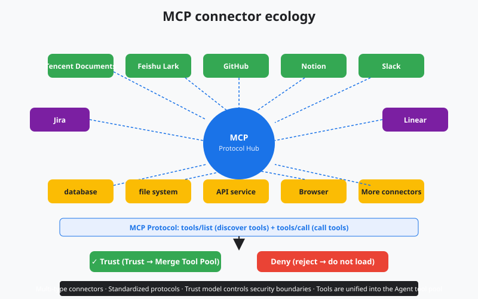
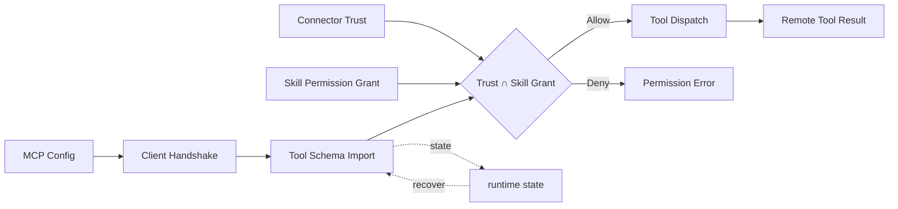

# s17: MCP Connectors - External Tools Need Trust and Grants

[中文](README.md) · [English](README.en.md)
> *A connector can expose tools, but trust and the active skill grant still decide visibility.*
>
> **Harness layer: external tool protocols and connector lifecycle.**

The lesson models configured, trusted, connected, and deferred MCP tools with namespacing and fail-closed permission checks.



## Code Architecture Diagram



## Prerequisites

- MCP standardizes external service capabilities into tools/list and tools/call.
- Connectors need a trust model; being discovered must not mean being executed automatically.
- External tools must also go through permissions, auditing, and the context budget.

## WorkBuddy-Style Mechanisms in This Chapter

- Simulate the MCP lifecycle with three stages: connector discovery, trust, and invocation.
- Generalize the MCPConnectors idea from public architecture research into multiple kinds of connectors.
- Show how MCP tools are merged into a unified tool pool.

## Common Mistakes

- "More connectors is better" is an illusion; tool bloat lowers the quality of tool selection.
- Exposing untrusted connectors directly to the model is high-risk.
- If MCP tools skip unified auditing, governance blind spots appear.
- Trusting a Connector does not mean every Skill may call all of its tools.

## The Problem

The s16 Skills system lets the agent load individual skills on demand. But a skill is essentially a prompt template: it tells the agent "how to do it", not new things it "can do".

What if your agent needs to read Tencent Docs, operate on GitHub PRs, or send Feishu messages? A prompt cannot solve these problems: you need to actually call the external services' APIs.

You could, of course, write each external service call directly into the agent's code. But that means changing the code and shipping a new release every time a service is added. 40 services means 40 changes. Worse, tools built by different teams cannot be reused: everyone builds their own GitHub integration.

MCP (Model Context Protocol) solves this. It defines a standard protocol: any tool that implements `tools/list` (list what you can do) and `tools/call` (execute a tool) can be discovered and used by any MCP client. Tool developers and agent developers are fully decoupled.

But "external tools" bring a security problem: a malicious connector can execute arbitrary commands or steal data. The first gate is the trust model: every connector must be manually "Trust"ed by the user before it is activated. The second gate is Skill permissions: a connected tool enters the deferred tool pool only when it also appears in the reviewed tool allowlist and network access is allowed.

---

## The Solution

```
                    MCP Connector Lifecycle

  configured ──► disconnected ──► trusted ──► connected
       │              │               │            │
       │              │               │            │
  mcp.json written   process not started      user clicks Trust   tools/list discovers tools
  configuration saved      tool pool remains hidden     trust is persisted       then intersect with the Skill Grant

           ┌──────────────────────────────────────┐
           │         Agent Tool Pool              │
           │                                      │
           │  Built-in Tools    MCP Tools         │
           │  ┌──────────┐    ┌────────────────┐ │
           │  │ bash     │    │ mcp__github__  │ │
           │  │ read     │    │   create_pr    │ │
           │  │ write    │    │ mcp__feishu__  │ │
           │  │ glob     │    │   send_msg     │ │
           │  │ grep     │    │ mcp__notion__  │ │
           │  │ ...      │    │   search       │ │
           │  └──────────┘    └────────────────┘ │
           └──────────────────────────────────────┘
```

| Stage | Meaning | Tool visibility |
|---|---|-----------|
| configured | Configuration written to `mcp.json` | Not visible |
| disconnected | Process is not running | Not visible |
| trusted | User has trusted it; process is waiting to start | Not visible |
| connected | Process started and `tools/list` completed | Only declared tools are visible, with deferred loading |

MCP protocol core methods:

| Method | Direction | Purpose |
|------|------|------|
| `tools/list` | client -> server | Discover available tools |
| `tools/call` | client -> server | Call a tool |
| `resources/list` | client -> server | List available resources |
| `resources/read` | client -> server | Read a resource |

---

## How It Works

### Connector Configuration

WorkBuddy's connector configuration lives in `mcp.json`:

```json
{
  "mcpServers": {
    "github": {
      "command": "npx",
      "args": ["-y", "@modelcontextprotocol/server-github"],
      "env": { "GITHUB_TOKEN": "ghp_xxx" }
    },
    "feishu": {
      "command": "npx",
      "args": ["-y", "@workbuddy/mcp-feishu"],
      "env": { "FEISHU_APP_ID": "cli_xxx", "FEISHU_APP_SECRET": "xxx" }
    }
  }
}
```

Each connector is an independent subprocess that communicates with the agent over stdio. After the configuration is parsed, the connector enters the `disconnected` state.

### Trust Model

```python
TRUST_FILE = Path.home() / ".workbuddy" / "connector_trust.json"

def is_trusted(connector_name: str) -> bool:
    """Check whether the connector has been trusted by the user."""
    trust_data = json.loads(TRUST_FILE.read_text()) if TRUST_FILE.exists() else {}
    return trust_data.get(connector_name, {}).get("trusted", False)

def trust_connector(connector_name: str):
    """The user manually trusts a connector."""
    trust_data = json.loads(TRUST_FILE.read_text()) if TRUST_FILE.exists() else {}
    trust_data[connector_name] = {"trusted": True, "timestamp": time.time()}
    TRUST_FILE.write_text(json.dumps(trust_data, indent=2))
```

Trust state is persisted in `~/.workbuddy/connector_trust.json`. An untrusted connector does not start its process, and its tools do not appear in the tool pool.

Trust only decides whether the Connector process may start; it does not decide which tools a Skill may call. The teaching implementation uses a separate `MCPPermissionGrant`:

```python
grant = MCPPermissionGrant(
    tools={"mcp__github__list_issues"},
    network=True,
)
manager = ConnectorManager(MCP_CONFIG, grant)
```

When the grant is omitted, it defaults to `NO_MCP_PERMISSIONS`: no tools are exposed even if the Connector is trusted. Updating or revoking the grant clears the loaded schemas; the execution stage checks again as well, closing the TOCTOU gap of "load first, revoke later, still executable".

### Tool Discovery

Once a connector is trusted and started, the agent sends a `tools/list` request:

```python
def discover_tools(connector_name: str) -> list[dict]:
    """Discover tools provided by the connector through MCP."""
    connector = connectors[connector_name]
    response = connector.request("tools/list", {})

    discovered = []
    for tool in response.get("tools", []):
        # namespace it: mcp__connectorname__toolname
        namespaced_name = f"mcp__{connector_name}__{tool['name']}"
        if not active_skill_grant.allows(namespaced_name):
            continue
        discovered.append({
            "name": namespaced_name,
            "description": tool["description"],
            "input_schema": tool["inputSchema"],
        })
    return discovered
```

Tool names are namespaced as `mcp__connectorname__toolname` to avoid conflicts with built-in tools or tools from other connectors.

### Deferred Tool Loading (Deferred Tools)

MCP tool schemas are not all loaded into the system prompt up front. They are "deferred tools": only when the agent needs one is its schema loaded through `ToolSearch`, and then it is executed through `DeferExecuteTool`:

```python
# tell the agent in the system prompt only which deferred tools are available
# do not include the full schema

DEFERRED_TOOLS = [
    {"name": "mcp__github__create_pr", "description": "Create a GitHub PR"},
    {"name": "mcp__feishu__send_message", "description": "Send a Feishu message"},
    # ... only name + description, without input_schema
]

# When the agent decides to use a deferred tool:
# 1. ToolSearch loads the schema
schema = tool_search("mcp__github__create_pr")  # check the Skill grant again
# 2. DeferExecuteTool executes
result = defer_execute_tool("mcp__github__create_pr", {"title": "...", "body": "..."})  # check again
```

This design solves the "tool explosion" problem: 40 connectors × 10 tools each = 400 tools. Stuffing the full schemas of 400 tools into the system prompt would waste a large number of tokens. Deferred loading lets the agent pay the cost only when it needs to.

### Connector State Injection

Connector state is injected into the system prompt so the agent knows which tools are available:

```python
def build_connector_context() -> str:
    """Build connector state context and inject it into the system prompt."""
    lines = ["<available_deferred_tools>"]
    for name, conn in connectors.items():
        if conn.status == "connected":
            for tool in conn.tools:
                if not active_skill_grant.allows(tool["name"]):
                    continue
                lines.append(f"- {tool['name']}: {tool['description']}")
    lines.append("</available_deferred_tools>")
    return "\n".join(lines)
```

---

## WorkBuddy Architecture Comparison

The MCP connector implementation of a production desktop agent is spread across several layers:

### Configuration Files

Connector configuration lives in two locations:
- User level: `~/.workbuddy/mcp.json`
- Project level: `connectors/default/mcp.json`

```json
{
  "mcpServers": {
    "tencent-docs": {
      "command": "npx",
      "args": ["-y", "@workbuddy/mcp-tencent-docs"],
      "env": { "TENCENT_DOCS_TOKEN": "..." }
    }
  }
}
```

### Connector Management

A production Sidecar is usually responsible for connector lifecycle management. Each connector is an independent Node.js subprocess that communicates over stdio. Connector state is exposed to the renderer process over RPC and shown in the settings UI.

### Trust Model Implementation

When the user sees a new connector in the settings UI, they need to click the "Trust" button. This action:
1. Writes the trust state to persistent storage
2. Starts the connector subprocess
3. Runs `tools/list` to discover tools
4. Intersects them with the current Skill's tool/network grant
5. Registers only the intersection in the deferred tool pool

An untrusted connector is shown in the "Not Trusted" state, and its tools are completely invisible. Tools that are trusted but not declared by the current Skill are invisible too, and cannot be called by bypassing the check through a directly constructed `DeferExecuteTool` call.

### Deferred Tool Loading

WorkBuddy's system prompt contains an `<available_deferred_tools>` block that lists the tool names and short descriptions of all connected connectors. The full `input_schema` is not included in the prompt.

When the agent needs to use an MCP tool, the system prompt instructs it to:
1. Use `ToolSearch` to load the tool's schema
2. Use `DeferExecuteTool` to execute the tool

This uses the same mechanism as the built-in deferred tools (such as `ImageGen` and `LSP`).

### Connector Ecosystem

WorkBuddy's built-in connector ecosystem:

| Connector | Capability |
|--------|------|
| `tencent-docs` | Read and write Tencent Docs |
| `github` | GitHub PR and issue operations |
| `feishu` | Feishu messages and documents |
| `notion` | Notion page management |
| `dingtalk` | DingTalk messages and approvals |
| `wecom` | WeCom messages |
| `ardot` | AR design-tool integration |

---

## Code Walkthrough

`code.py` simulates the full lifecycle of an MCP connector:

1. **Connector configuration parsing** — load connector definitions from a JSON configuration
2. **Trust model** — simulate the user's trust/reject interaction with a connector
3. **Tool discovery** — simulate the `tools/list` protocol method
4. **Deferred tool loading** — simulate the `ToolSearch` + `DeferExecuteTool` pattern
5. **Namespacing** — tool names take the form `mcp__connectorname__toolname`
6. **Permission intersection** — Connector trust, network permission, and the Skill tool allowlist are all required
7. **Double check** — both `ToolSearch` and `DeferExecuteTool` fail closed
8. **State injection** — only allowed connector tools are injected into the system prompt

Built-in simulated connectors:
- `github` — simulates GitHub PR creation
- `feishu` — simulates sending a Feishu message
- `notion` — simulates Notion page search

---

## Run

```bash
python s17_mcp_connectors/code.py
python -m pytest -q tests/test_skill_permissions.py
```

Try these inputs ([REPL] items are slash commands handled directly by the REPL; [Model] items are prompts sent to the model and need a configured model):

1. [REPL] `/list` (show connector status)
2. [REPL] `/trust github` (simulate the trust flow)
3. [Model] `Create a PR on GitHub to add dark mode` (uses an MCP tool; finish step 2 first)
4. [Model] `Send a message on Feishu saying hello` (uses another connector; run `/trust feishu` first, or use `/trustall`)

What to watch: tools of untrusted connectors stay invisible; after trust, an explicit Skill grant is still required. Tools in the intersection first load their schema through ToolSearch, then are re-validated and executed through DeferExecuteTool.

## Exercises

1. Add a new simulated connector (such as `dingtalk`) with a `send_work_message` tool. Observe how namespacing avoids conflicts.
2. Implement simulations of `resources/list` and `resources/read` so a connector can expose "resources" (such as a document list), not only tools.
3. Implement a connector health check: if a connector process crashes, automatically roll its state back to `disconnected` and remove its tools from the tool pool.

---

## Next Lesson

s17 lets the agent plug in an unlimited number of external tools. But tools are "points": each provides a single operation. What if you need the agent as a whole to become an expert in some domain? For example, to think like a software company's architect, or to analyze like a trend researcher?

s18 Experts System → expert packs that load domain knowledge as a whole package.

The original Chinese README remains the primary-language reference. This English companion keeps the same code, diagrams, local paths, and chapter structure so readers can switch languages without losing runnable details.

Local references:

- [Reference](README.md)
- [Reference](README.en.md)
- [Reference](./images/mcp-connectors-en.svg)
