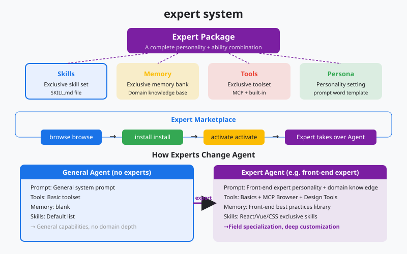
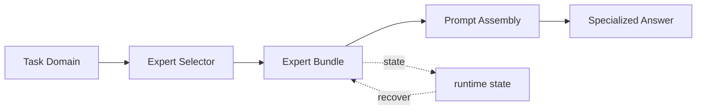

# s18: Experts System - Load a Domain Bundle

[中文](README.md) · [English](README.en.md)
> *Skills add capabilities; expert bundles change how the agent approaches a domain.*
>
> **Harness layer: domain knowledge, routing, and persona/tool/memory composition.**

An expert is a governed package of persona, memory, tools, skills, and output rules selected for a task domain.



## Code Architecture Diagram



## Prerequisites

- An expert is a domain work package, not just another random prompt.
- An expert usually bundles a persona, memory, tools, skills, and output conventions.
- Switching experts must change the context, and also the tools and risk boundaries.

## WorkBuddy-Style Mechanisms in This Chapter

- Treat domain experts as high-level routing targets.
- Show how an expert package affects prompt assembly and the tool pool.
- Connect s08 model routing with the s16/s17 extension systems.

## Common Mistakes

- Changing only the name without changing tools and memory does not make a real expert.
- Too many experts with no routing criteria will leave users lost.
- An expert package that bypasses the permission system creates a security hole.

## The Problem

The Skills system in s16 lets the agent load single skills on demand. The MCP connectors in s17 let the agent reach external tools. But both are "incremental": they give the agent one more tool or one more skill without changing its basic behavior pattern.

What if you need the agent to think like the technical director of a software company? What if the user wants the agent to review an interface from a UI designer's point of view? What if the task is industry trend research, which needs a whole research methodology rather than a single tool?

"Adding a skill" cannot solve this. What you need is to change the agent's "persona": its system prompt, its tool configuration, its default behavior pattern, and its knowledge background. A single skill is a drop of water; a domain expert is an entire ocean.

WorkBuddy's Experts system solves this problem. An expert package is not a single skill but a bundle of a whole set of domain knowledge: a specialized system prompt, tool configuration, skill bundles, and behavior guidelines. Select an expert, and the agent's whole cognitive frame changes.

## The Solution

```
              Expert Package Structure

  ┌────────────────────────────────────────┐
  │           Expert Package               │
  │                                        │
  │  ┌──────────────────────────────────┐  │
  │  │ system_prompt_specialization     │  │  ← reshape the agent's persona
  │  │ "You are a senior software       │  │
  │  │  architect at a tech company..." │  │
  │  └──────────────────────────────────┘  │
  │                                        │
  │  ┌──────────────────────────────────┐  │
  │  │ tool_configurations              │  │  ← domain-specific tools
  │  │ preferred_tools: [arch, uml]     │  │
  │  │ disabled_tools: [casual_chat]    │  │
  │  └──────────────────────────────────┘  │
  │                                        │
  │  ┌──────────────────────────────────┐  │
  │  │ skill_bundles                    │  │  ← bundled skill set
  │  │ [code_review, arch_design,       │  │
  │  │  tech_doc, api_design]           │  │
  │  └──────────────────────────────────┘  │
  │                                        │
  │  ┌──────────────────────────────────┐  │
  │  │ behavior_guidelines              │  │  ← behavior guidelines
  │  │ - Always consider scalability    │  │
  │  │ - Prefer documented patterns     │  │
  │  └──────────────────────────────────┘  │
  └────────────────────────────────────┘

         Skills vs Experts
         ─────────────────

  Skill:  add one capability (a point)        "I can now review code"
  Expert: switch personas (a surface)        "I am a software architect"
```

| Dimension | Skills (s16) | Experts (s18) |
|------|-------------|---------------|
| Granularity | One capability | An entire domain |
| Loading | Triggered on demand | Activated for a session |
| Scope | One call or task | The personality of the session |
| System prompt | Adds skill instructions | Replaces or strengthens core instructions |
| Tool configuration | Does not change | May enable or disable domain tools |
| Persistence | Temporary load | Recorded in session metadata |
| Quantity | Several can be active | Usually one active expert |

## How It Works

### Expert Package Structure

```python
@dataclass
class ExpertPackage:
    """A domain expert package."""
    expert_id: str          # unique identifier
    name: str               # display name
    category: str           # category
    system_prompt: str      # specialized system prompt
    tools_config: dict      # tool configuration
    skill_bundles: list     # bundled skills
    guidelines: list        # behavior guidelines
    description: str        # short description
```

### Expert Loading and Caching

```python
EXPERTS_CACHE = Path.home() / ".workbuddy" / "app" / "cache" / "experts" / "metadata.json"

def load_expert(expert_id: str) -> ExpertPackage:
    """Load an expert package from cache or marketplace."""
    cache = json.loads(EXPERTS_CACHE.read_text()) if EXPERTS_CACHE.exists() else {}

    if expert_id not in cache:
        # Fetch from marketplace
        cache[expert_id] = fetch_from_marketplace(expert_id)
        EXPERTS_CACHE.write_text(json.dumps(cache, indent=2))

    return ExpertPackage(**cache[expert_id])
```

### System Prompt Injection

When an expert is activated, its specialized system prompt is injected into the agent's system prompt:

```python
def build_system_prompt(base_prompt: str, expert: ExpertPackage | None) -> str:
    """Build system prompt with optional expert specialization."""
    if not expert:
        return base_prompt

    return f"""{base_prompt}

<expert_specialization>
You are now operating as: {expert.name}

{expert.system_prompt}

<behavior_guidelines>
{chr(10).join(f'- {g}' for g in expert.guidelines)}
</behavior_guidelines>
</expert_specialization>"""
```

### Session Persistence

The expert selection is recorded in the session metadata:

```python
# the expert_id field in the sessions table
session = {
    "session_id": "abc123",
    "expert_id": "SoftwareCompany",  # currently active expert
    "created_at": "...",
    # ...
}
```

When the user reopens a session, the system reads `expert_id` and reloads the matching expert package.

### Switching Experts

```python
def switch_expert(session_id: str, new_expert_id: str):
    """Switch the active expert for a session."""
    old_expert = get_session_expert(session_id)
    new_expert = load_expert(new_expert_id)

    # Update session metadata
    update_session(session_id, expert_id=new_expert_id)

    # Rebuild system prompt
    system_prompt = build_system_prompt(BASE_PROMPT, new_expert)

    print(f"Switched expert: {old_expert.name} → {new_expert.name}")
```

## WorkBuddy Architecture Comparison

This comparison maps expert packages, prompt injection, registry state, and switching to the corresponding WorkBuddy-style harness boundary.

### Expert Center

The expert center of a production desktop agent (Expert Center) contains 100+ domain experts:

| Category | Expert example | Function |
|------|---------|------|
| Software development | SoftwareCompany | Architecture, code review, and technical documents |
| Design | UiDesigner | UI/UX review and design systems |
| Research | TrendResearcher | Trend research, data analysis, and reports |
| Finance | FinancialAnalyst | Financial reports, valuation, and industry research |
| Writing | ContentWriter | Content strategy, copywriting, and SEO |
| Product | ProductManager | Product planning, requirements, and PRDs |

### Expert Package Cache

Expert package metadata is cached in `~/.workbuddy/app/cache/experts/metadata.json`:

```json
{
  "SoftwareCompany": {
    "expert_id": "SoftwareCompany",
    "name": "Software Company Expert",
    "category": "Software Development",
    "system_prompt": "You are a senior software architect...",
    "guidelines": ["Always consider scalability", "Prefer documented patterns"],
    "skills": ["code_review", "arch_design", "tech_doc"]
  }
}
```

### expert-manager Skill

WorkBuddy ships a built-in `expert-manager` skill that handles the full lifecycle of expert packages:

- **Create**: turn an open-source repository or a local project into an expert package
- **Edit**: change an existing expert's system prompt and tool configuration
- **Compliance check**: verify that the expert package content follows the conventions
- **Batch update**: update several expert packages at once
- **Quality review**: check the quality and completeness of expert packages

### System Prompt Injection

When WorkBuddy assembles the system prompt in s15 (Prompt Assembly), it checks the current session's `expert_id`. If an expert is active, its specialized instructions are wrapped in an `<expert_specialization>` tag and injected at the end of the system prompt.

This injection happens in the last stage of prompt assembly, after SOUL, IDENTITY, and USER. The expert does not override the core identity; it layers domain expertise on top of it.

### Expert Marketplace

Users can browse and install expert packages through the expert marketplace. The `expertMarketplace` parameter helps the system locate where an expert package comes from:

- Built-in marketplace: the expert library that ships with WorkBuddy
- Third-party marketplace: expert packages contributed by the community
- Local import: converted from a local project

## Code Walkthrough

`code.py` simulates the core mechanisms of the expert system:

1. **Expert package definitions** — 3 built-in simulated expert packages (software architect, UI designer, trend researcher)
2. **Expert loading and caching** — simulates the `metadata.json` cache mechanism
3. **System prompt injection** — injects the specialized prompt into the system prompt when an expert is activated
4. **Session persistence** — records the currently active expert
5. **Expert switching** — switches experts at runtime and rebuilds the system prompt
6. **Behavior guidelines** — the expert's guidelines shape the agent's behavior

## Run

```bash
python s18_experts_system/code.py
```

Try these prompts:

1. `/list` — list all available experts
2. `/use SoftwareCompany` — activate the software architect expert
3. `Design a microservices architecture for an e-commerce platform` — watch the answer from the expert's perspective
4. `/use TrendResearcher` — switch to the trend researcher
5. `Analyze the AI chip market trends` — watch how different experts bring different perspectives

What to watch: after switching experts, the agent's answer style and professional focus clearly change. The expert specialization in the system prompt shapes the agent's behavior.

## Exercises

1. Create a new expert package (such as `FinancialAnalyst`) with a system prompt and behavior guidelines for financial report analysis. Observe how it changes the way the agent answers financial questions.
2. Implement expert composition: allow two experts to be active at once and inject both experts' system prompts merged together. Think about it: what problems does this cause? Why does WorkBuddy usually activate only one?
3. Implement expert recommendation: automatically recommend the most suitable expert based on the content of the user's question. For example, recommend `SoftwareCompany` when the user asks about architecture design.

## Next Lesson

s18 lets the agent switch "personas" to become a domain expert. But so far, all of the agent's output has been plain text. What if the agent could draw? Not by generating images, but by rendering SVG charts, flowcharts, and interactive widgets directly in the conversation?

s19 Visualizer → streaming SVG/HTML widget injection.

The original Chinese README remains the primary-language reference. This English companion keeps the same code, diagrams, local paths, and chapter structure so readers can switch languages without losing runnable details.

Local references:

- [Reference](README.md)
- [Reference](README.en.md)
- [Reference](./images/experts-system-en.svg)
